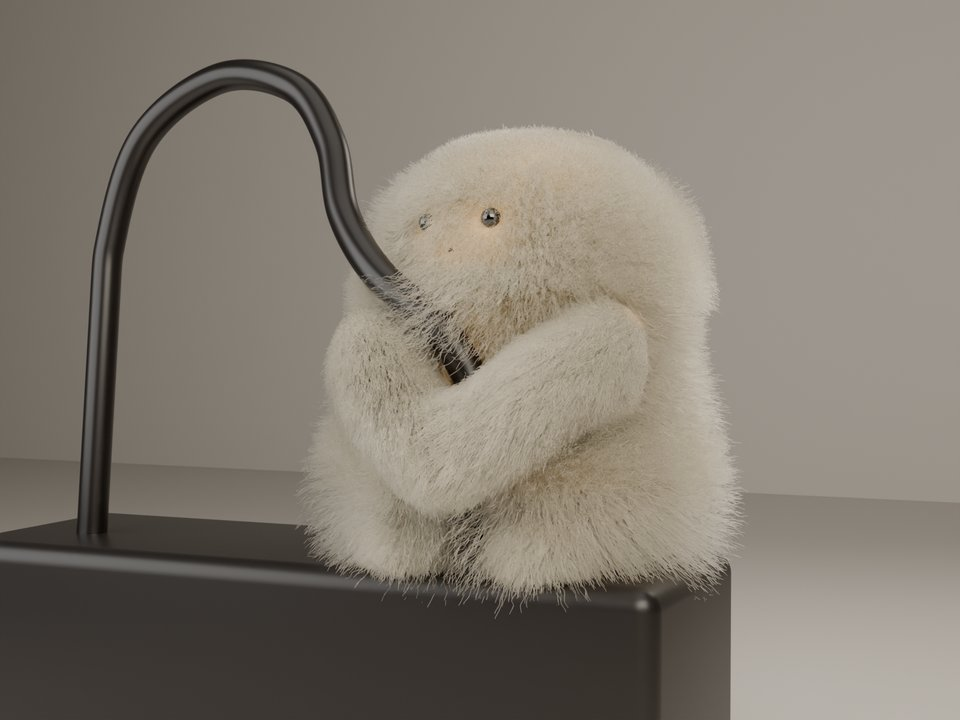
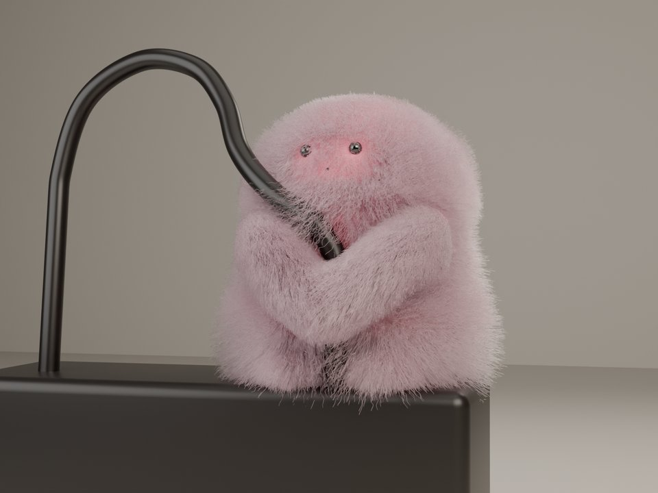
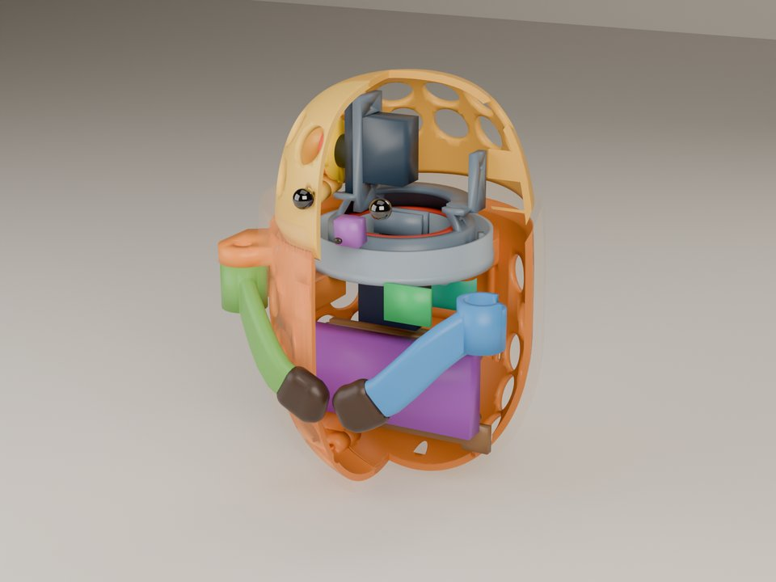
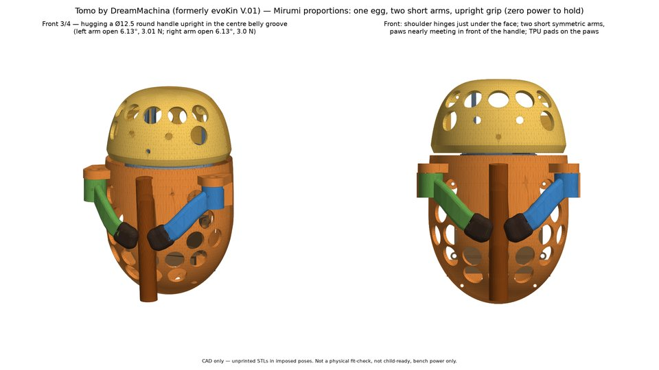
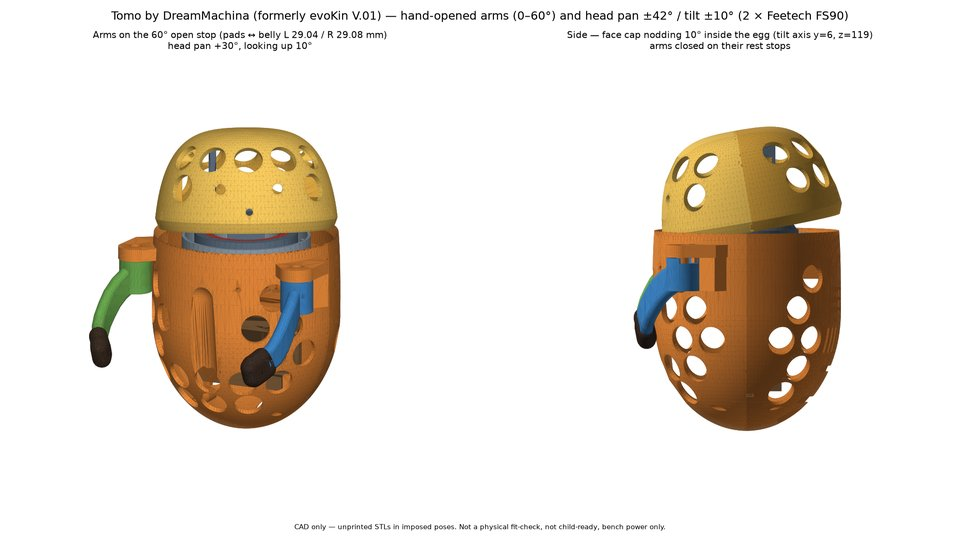
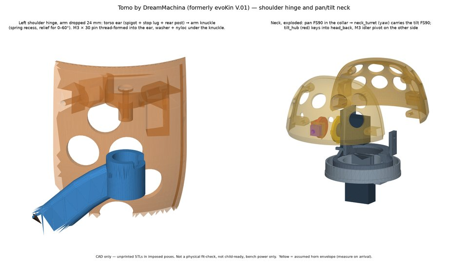

# Tomo by DreamMachina (formerly evoKin V.01)

[](media/evokin_demo_ad_v3_real.mp4)

**[Watch the 10-second photoreal ad (MP4, 3.3 MB)](media/evokin_demo_ad_v3_real.mp4)** · [Mirumi-style take](media/evokin_demo_ad_v2.mp4) · [First hatch take](media/evokin_demo_ad.mp4)

Tomo is an open-source plush robot companion: a small, long-haired, Mirumi-style critter (ivory or pink) that **hugs** a bag strap or handle with spring-loaded arms, and looks around, nods and turns away shyly with a two-servo head. Inside the fur is a lightened 3D-printed shell, two 9 g Feetech FS90 servos (head pan and head tilt), two small torsion springs for the arms, a 400 mAh LiPo and a planned ESP32-S3 brain with a camera and a voice. It weighs about **194 g with its battery** (estimate; was ≈334 g). This repository holds the V.01 CAD, the printable STLs, the bill of materials, a head-motion firmware sketch and the concept renders.

Repository: [github.com/Hewlbern/Tomo](https://github.com/Hewlbern/Tomo) · Landing page: [hewlbern.github.io/Tomo](https://hewlbern.github.io/Tomo/)

> **The videos show an older design.** The clips above are generated concept advertisements, not footage of a built unit, and they still show the v3 design (arms clasping backward around a strap). They have not been regenerated for the passive hug. The [renders](#how-it-looks) and the CAD are the design source of truth. Nothing has been printed, assembled or purchased. Tomo is a bench prototype: not child-ready, not waterproof and not a production kit.

## How it looks

Sitting on a tote and clinging to the upright leg of its Ø12.5 mm handle the way Mirumi does: the handle runs up the centre groove, then rises past the side of the head and over the shoulder, and the two short, thick, furry arms come round from the shoulders and meet in front of it under spring force. Short pear / bell-shaped body (wider at the bottom), long shaggy ivory locks falling downward, two stubby splayed feet on the bag top, small black bead eyes set high and wide, and a barely visible nose (Blender fur model):

[](renders/blender/01_hero_hug_handle.png)

Arms pulled open by hand to the 60° stop, head panned 20° (ivory):

[](renders/blender/02_arms_open.png)

Our own render in the second colourway (pink), framed roughly like Mirumi's product photo (front 3/4, camera slightly low). No Mirumi images are stored in this repository:

[](renders/blender/03_mirumi_angle.png)

Cutaway: lightening windows in the shells, shoulder hinges and arms, neck turret with the tilt servo, the nose camera pod, mini speaker and board, face cap nodding 8°:

[](renders/blender/04_cutaway_shoulder_tilt.png)

CAD, hugging a Ø12.5 handle upright in the centre groove (front 3/4 and front):

[](renders/cad/v01_hug_handle.png)

CAD, arms open with the head panned and looking up, and nodding 10°:

[](renders/cad/v01_arms_open_tilt.png)

CAD, shoulder hinge and pan/tilt neck exploded:

[](renders/cad/v01_shoulder_turret_exploded.png)

Full-resolution PNGs live in [`renders/blender/`](renders/blender/) and [`renders/cad/`](renders/cad/). The Blender scene is [`renders/blender/evokin_v01_fur.blend`](renders/blender/evokin_v01_fur.blend). A landing page with the video inline is in [`docs/index.html`](docs/index.html), served by GitHub Pages at [hewlbern.github.io/Tomo](https://hewlbern.github.io/Tomo/).

## How it works

### Lighter Tomo: weight budget

Estimated from the exported STLs (PLA 1.24 g/cm³ × an ASSUMED effective fill per part) plus listed component masses; nothing has been weighed. Full numbers: [`results/metrics_v01.json`](results/metrics_v01.json) → `mass`.

| Item | Before (6ad85c3) g | After g | Change |
|---|---:|---:|---|
| shells (torso + head, 4 parts) | 106.3 | 61.5 | lightening windows (Ø14 on a 17.5 mm hex, only on plain 2.4 mm wall; fur covers them) + 1-perimeter/10 % print profile |
| arms | 22.3 | 9.1 | two short symmetric arms (≈55 mm along the spine, were ≈82 / 111 mm), band r 3.0, 2-perimeter PETG profile |
| TPU pads | 4.0 | 2.1 | on the paws only |
| tray | 11.5 | 7.7 | 0.50 profile |
| yaw collar | 15.3 | 12.2 | 0.60 profile |
| turret + hub + yaw small parts | 10.4 | 9.9 | 0.60 turret profile |
| eye bezels + shutter (removed) | 6.0 | 0.0 | replaced by 8 mm safety eyes |
| servos (2 × FS90MG → 2 × FS90, + horns) | 28.8 | 20.0 | Feetech FS90, same case |
| speaker (Adafruit 3351 → 3923) | 25.0 | 3.0 | 30 × 20 × 5 mm mini oval |
| brain + camera | 8.0 | 7.5 | XIAO Sense 6.6 g + long-FPC camera |
| amp + mic | 3.0 | 3.0 | unchanged |
| INA219 + boost (XL6009 → Pololu U3V16F5) | 7.0 | 2.4 | 0.4 g boost |
| wiring | 8.0 | 5.0 | trimmed 30 AWG (assumed) |
| fasteners (→ nylon M2.5 shell screws) | 8.0 | 5.5 | nylon shell screws |
| springs | 2.0 | 2.0 | unchanged (grip kept) |
| 8 mm safety eyes | 0.0 | 0.8 | new |
| fur skin (→ long pile + feet) | 30.0 | 21.0 | light knit-backed long pile ≈380 g/m² (assumed) + feet |
| thick arm sleeves (fibrefill + extra fur) | 0.0 | 1.4 | stuffed Ø16–18 mm tubes, shoulder caps, mittens (assumed 15 kg/m³, 380 g/m²) |
| pear padding, feet, shaggy pile | 0.0 | 8.8 | fibrefill padding in the lower body (78 cm³) and two plush feet (12 cm³), 1.4 g; longer, heavier shaggy pile (assumed 480 g/m² vs 380) + extra skin, 7.4 g |
| battery (1S 2000 mAh → 400 mAh) | 38.0 | 11.0 | Core CE04375 |
| **Total with battery** | **334** | **194** | **−140 g (−42 %)** |

**194 g against a 160–180 g target (200 g ceiling)** (185 g at 494c22f; the closer-to-Mirumi soft goods — pear padding, feet and a heavier shaggy pile — add ≈9 g; 191 g at b458259). Mirumi is about 135–155 g. The last ≈14 g is in the shaggy coat and in parts this pass kept on purpose: the two servos (20 g with horns) and the printed yaw collar / neck turret that carry pan **and** tilt, which Mirumi does not have, plus the spring hinges. The next step down would be two sub-micro servos (≈4–5 g each, ≈−11 g) with new seats in the collar and turret; dropping the camera saves only ≈1.5 g. Print profiles: shells 1 perimeter per face + 10 % gyroid (≈0.48 of solid), arms 2 perimeters PETG (0.62), collar / turret 0.60, tray 0.50, small bearing parts 0.75. Solid-print upper bound (every printed part 100 % solid, no battery): 276 g.

**Parts swapped (planned, nothing bought):**

| Was | Now | Mass | Source |
|---|---|---:|---|
| 2 × Feetech FS90MG (13.4 g) | 2 × **Feetech FS90**, plastic gear, 1.3 kg·cm @4.8 V / 1.5 @6 V, stall 700/800 mA, 21T, same 22.5 × 12.1 × 22.4 case | 9 g each | [Feetech](https://www.feetech.cn/en/6v-15kg-9g-dc-reduction-steering-gear-tooth-box) · [spec PDF](https://www.feetech.cn/Data/feetechrc/upload/file/20200612/6372758162968290344365716.pdf) · [Core CE09376, A$5.70](https://core-electronics.com.au/feetech-fs90-1-5kgcm-micro-servo-9g.html) |
| Adafruit 3351 enclosed speaker (25 g) | **Adafruit 3923** mini oval, 8 Ω 1 W, 30 × 20 × 5 mm, on the inside of the back shell | 3 g | [Adafruit 3923](https://www.adafruit.com/product/3923) · [Core ADA3923, A$4.80](https://core-electronics.com.au/mini-oval-speaker-8-ohm-1-watt.html) (out of stock Nov 2026) |
| XL6009 boost module | **Pololu U3V16F5** 5 V step-up, 13.1 × 8.1 × 3 mm | 0.4 g | [Pololu 4941](https://www.pololu.com/product/4941) · [Core, A$11.70](https://core-electronics.com.au/5v-step-up-voltage-regulator-u3v16f5.html) |
| 1S 2000 mAh (≈38 g, not sourced) | **1S 400 mAh LiPo**, 38 × 25 × 6 mm, PCM, 2C, JST-PH | 11 g | [Core CE04375, A$5.55](https://core-electronics.com.au/polymer-lithium-ion-battery-400mah-38456.html) |
| Printed eye bezels + shutter (6 g) | **8 mm black safety eyes** with push-on washers (Ø5 shank holes) | 0.8 g | not sourced |
| Pi-camera block behind the eyes | XIAO ESP32S3 Sense camera (OV3660/OV5640) on a long FPC in a small **nose pod** behind a Ø3.5 window | — | [Seeed XIAO ESP32S3 Sense](https://www.seeedstudio.com/XIAO-ESP32S3-Sense-p-5639.html) |

The springs are unchanged, so the grip is unchanged, and the lighter body makes both holding cases safer (below).

### Mirumi look

- **Pear / bell silhouette.** A soft-goods body (`stl/reference/soft_body.stl`, not printed): a 4 mm skin layer over the egg plus fibrefill padding sewn into the lower body, up to 9 mm thick below z 28 and blending out by z 50, so the body is widest at the bottom and tapers to a rounded head. Over the pile Tomo reads about **136 mm wide at the bottom, ≈106 mm at the head and ≈156 mm tall (height ≈1.15× width)**, against ≈120 × 160 mm before (estimates from the proxy plus the pile length).
- **Feet.** Two stubby, rounded plush feet (ellipsoids 32 × 26 × 18 mm) at the bottom front, splayed ±34° from the front centre, resting on the bag top. Fibrefill and fur only.
- **Long shaggy fur.** Clumped, wavy locks that fall downward: ≈13 mm undercoat and 36 mm guard hair on the body, 11 / 27 mm on the head, 9 / 20 mm on the arms, 14 mm on the feet; one uniform colour (ivory or pink), no white-tipped halo. The face cap's pile runs past the seam and falls over the body pile, hiding the 3 mm running gap when the head is level (it can still part when the face looks up).
- **Small, flatter face.** Two 8 mm black bead eyes set high and wide (x ±14, z 121; were ±10.5, z 114), a tiny, barely visible nose over the camera window at z 110, and a small oval of shorter, trimmed fur round them; the crown fur is shorter so the face reads flatter.
- **No visible hardware.** Each shoulder knuckle sits under a stuffed shoulder cap; the TPU pads sit on the inner face of the mittens, fur-coloured and hidden by the pile.
- **Two thick, stubby arms.** Each printed arm is a short spine inside a stuffed fur sleeve (Ø16 at the root, Ø18 along the arm, Ø21 mitten, Ø22 shoulder cap; ≈Ø26–30 mm over the pile). The two mittens are flattened where they meet in front of the handle, 1.5 mm apart at rest, so the paws never cross or overlap.
- **Pose on the handle.** In the renders the handle runs up the centre groove past the paws, then curves up beside the head and over the right shoulder (staging only; the groove and grip are unchanged), and the feet rest on the bag top.
- **Printed size unchanged.** The printed egg is still Ø92 × 148 mm: the turret and tilt servo reach the dome, so the visible drop in height comes from the shorter crown fur, not the shell. Mirumi is ≈100 × 118 × 143 mm including its pile.

### Mirumi proportions

- **One egg, no snowman.** Head and body are a single egg of revolution: radius 46 mm at z = 58, an ellipse below and a blunt superellipse dome (n = 3.4) above, 148 mm tall. With the earlier 4–7 mm fur Tomo was about **106 × 104 × 152 mm** (width over the arm knuckles × depth × height) against Mirumi's ≈100 × 118 × 143 mm. It is about 9 mm taller than Mirumi because the eyes, camera and tilt servo have to sit at z ≈ 120.
- **The face is a cap.** A seam sphere centred on the tilt-axis line (radius ≈48.3 mm, meeting the skin at z ≈ 101 with a 3 mm gap) cuts the face cap off the egg. Because the egg is round in plan, the cap pans and tilts inside the body with a matching skin. The long pile and a fur lip on the cap now cover the 3 mm seam (see Mirumi look).
- **Shoulder arms.** The arm hinges moved from the hip (z 22–38) to the shoulders, just under the face (knuckle z 70–86, axis 54.4 mm from the centre at azimuth ±35° from the side).
- **Two short, symmetric arms (two-arms pass).** Each arm runs from its own shoulder round its own side of the body to the front, ≈55 mm along the spine, ending at z ≈ 48 with the paw at azimuth ±7.5° from the front centre. The right arm is the left mirrored. The printed spine is a 6 × 14 mm band that follows the skin 8.5 mm out (5.3 mm at the paws). The earlier asymmetric arms (left over the chest, right under the belly, 82 and 111 mm long) crossed each other in front of the belly and read as one tangled limb.
- **Upright, centre grip.** The belly groove runs down the front centre, **5.9° from vertical**, so the upright leg of a bag handle runs up the belly between the paws like Mirumi's. It is shallow (floor 2.5 mm below the skin at z 33, 4 mm at z 64): the paws reach round the front of the handle, so it does not need to sit deep.

### Passive spring hug

- **Hinge.** Each knuckle turns on a **vertical M3 × 30 pin** thread-formed into an ear moulded into `torso_front` (z 86.4–92.4), with a washer and nyloc under the knuckle. There is no lower cap any more, so the arm band can leave the knuckle downwards; a rear post ties the ear back into the shell, away from the arm swing.
- **Spring.** A music-wire **torsion spring** sits in a Ø11 recess in each knuckle: 0.048 in (1.22 mm) wire, 3/8 in OD, 90° legs — catalogue part Approved Vendor / Grainger **3HPG6 (left-hand)** and **3HPD1 (right-hand)**, rated 2.679 lbf·in (302.7 N·mm) at 90°, so **3.36 N·mm per degree**. It is preloaded **30°** at the closed stop and winds to **90°** at the open stop: exactly its catalogue rating, with no margin (≈1.87 GPa against ≈1.86 GPa at the rating). The preload was cut from 50° when the open stop went from 30° to 60°.
- **Stops.** A printed lug on the torso ear runs in a relief in the top of the knuckle: the arm rests closed at 0° and opens to a hard stop at **60°** (was 30°: at 30° no straight path in for a Ø15 handle existed). Zero power holds the hug; you open the arms by hand (about 7.7 N at each paw on the open stop) and let go.
- **Pads.** 1.5 mm **TPU sleeves** (`paw_pad_L/R`) cover the paw end of each arm (the last ≈15 mm) and press on the front quarters of the handle from either side; they take the squash and give the grip its friction, and the rigid arm stays ≈1.4 mm clear of the handle. At rest the two pads are 2.2 mm apart and 0.28 mm off the belly. With both arms on the open stop the pads are ≈29 mm off the belly and a Ø15 handle comes straight in (any approach within ±30° of the groove normal is clear). You load it like Mirumi: open the arms, put the handle upright against the belly, let go.
- **Handles.** Round **Ø10–15 mm** and a flat strap up to **25 × 2.5 mm** laid along the groove.

**Clamp force (catalogue spring rate, not measured).** The two paws close on the handle from either side; pad force = spring torque ÷ the lever from the hinge axis to the pad contact (≈39–41 mm; 32 mm on the strap):

| Handle in the groove | Left arm opens / force | Right arm opens / force | Total pad force | Into the groove |
|---|---:|---:|---:|---:|
| Ø10 round | 3.2° / **2.8 N** | 3.2° / **2.8 N** | 5.7 N | 3.6 N |
| Ø12.5 round | 6.1° / **3.0 N** | 6.1° / **3.0 N** | 6.0 N | 3.8 N |
| Ø15 round | 9.0° / **3.2 N** | 9.0° / **3.2 N** | 6.4 N | 4.0 N |
| Flat strap 25 × 2.5 | 5.0° / **3.7 N** | 5.0° / **3.7 N** | 7.4 N | 7.4 N |

Assumptions: linear catalogue rate, no hinge friction, rigid TPU for the angle. The rest of each round-handle force (≈2.2 N per paw) squeezes the handle sideways between the paws. **Clinging check (Mirumi pose):** about 183 g without the battery, **194 g with it** (centre of mass at z ≈ 71–74). Sitting on the bag top, the bag carries the weight and the hug only has to keep it upright: with 6.0 N on the handle at a mean height of 52 mm, the springs give **2.28×** the moment needed even to hold it horizontal (2.35× before the heavier coat). **Hanging free** from a vertical handle is held by friction only (μ ≈ 0.5 assumed): slip safety factor **≈3.15 with the battery** (3.34 without; was 3.3 / 3.5), 3.15–4.1 across the handle sizes without the battery. On paper both hold; real handles and fur will decide.

### Head: pan and tilt (2 × Feetech FS90)

- **Pan.** A Feetech FS90 (plastic gear, same case as the FS90MG) in the `yaw_collar` turns a coupler blade in a slot on the **`neck_turret`**, which carries the tilt servo. Software clamps pan to ±42°; the printed hard stop is at ±47°.
- **Tilt / nod.** A second FS90 lies across the turret with its spline on a tilt axis along x through y = 6, z = 119. A printed `tilt_hub` on the horn keys into `head_back`; an M3 idler screw is the bearing on the other side. Software clamps tilt to **±10°**; the first rigid contact is at **+13.5°** nodding down (the camera pod reaches the collar; its inner edge is chamfered 45° for this) and **−23.5°** looking up (collar). The look-around and nod behaviours are unchanged. Loads: tilt gravity 1.7 % and pan acceleration 8.4 % of the FS90's stall torque.
- **Cables.** The pan servo's lead never crosses a moving joint. The tilt servo rides on the turret, so its lead crosses the pan joint and needs a ≥40 mm service loop down the Ø34 collar bore, tied to the camera FPC. The camera now sits in a small pod at the nose (z 110), its lens 0.5 mm behind a Ø3.5 window, on a long 24-pin FPC.

### Firmware

[`firmware/evokin_v01/evokin_v01.ino`](firmware/evokin_v01/evokin_v01.ino) (ESP32Servo, XIAO ESP32S3, pan on D0, tilt on D1) has three behaviours — **look-around**, **nod** and a **shy turn-away** — with eased moves, the ±42° / ±10° clamps, and a limp mode between moves. Lighter Tomo: comments and limits updated for the FS90 (same pulse range), and a `ONE_JOINT_AT_A_TIME` switch (on by default) moves pan and tilt in turn so the peak current stays inside the 400 mAh cell (2C = 0.8 A) and the U3V16F5 (≈1 A at 5 V); the head goes limp between behaviours. The arms need no firmware. Untested.

The shells close on a male/female registration lip (0.25 mm FDM clearance) with one fastener scheme: M2.5 at 2.8 mm clearance / 2.1 mm pilot. Print [`stl/coupon.stl`](stl/coupon.stl) first if you print anything.

Naming: `arm_L` is the **critter's own left** (+x). Units are millimetres; the CAD frame is z up, −y face. Internal file names keep the `evokin_` prefix so the build pipeline is unchanged.

## Trade-offs

- **Passive arms cannot move on their own.** No wave, no motorised hug: a person opens the arms and the spring closes them. In exchange there is no arm current, no gear train to strip, nothing to back-drive and no grip interlock.
- **Grip is modest and fixed.** About 2.8–3.7 N per paw, 5.7–7.4 N in total (the previous arms gave 6.1–7.3 N), set by the spring: the preload had to come down from 50° to 30° so the wider 60° opening stays inside the spring's 90° rating. A spring rated for more wind-up (or a slightly stiffer one) would restore it but makes the arms harder for small hands to open; 7.7 N per paw already holds them fully open. Spring price is uncertain (see the BOM).
- **Spring at its rating.** Fully open, the springs sit exactly at their 90° catalogue rating with no margin; do not force the arms past the stop.
- **Small handles have little follow-through.** A Ø10 handle opens the pads only 3.2° (the rigid spine 1.1°): about 2 mm of squash at the paw. Handles under Ø10 may not be held.
- **Taller than Mirumi.** The printed egg stays 148 mm tall (≈156 mm over the shorter crown pile) against ≈143 mm; the pear shape comes from soft padding and fur, not the shell: the pan/tilt neck stack and the tilt servo reach the dome, so lowering it needs a new neck stack or sub-micro servos. The arm knuckles stick out ≈8 mm beyond the egg at the shoulders, under the stuffed shoulder caps.
- **Arms hug at mid-body, not the upper chest.** The paws still meet at z ≈ 48; Mirumi's hug sits higher. Raising it needs new arm geometry and a new groove/handle check, so this pass only restaged the handle to rise beside the head.
- **The coat is soft and squashes.** The pear padding and pile sit ≈3 mm under the paws at rest (they compress; the rigid parts stay clear), and the shaggy pile is heavier (≈+9 g, assumed 480 g/m²). Feet and padding are sewn soft goods with no printed support.
- **The face seam is hidden, not gone.** The cap needs a 3 mm running gap round the egg. The long pile and the cap's soft fur lip cover it when the head is level; a faint line can still show at some angles, and it opens when the face looks up.
- **The groove is shallow.** 2.5–4 mm deep, so the handle stands proud of the belly and the paws do the locating; a handle that is not upright (more than ≈30° off) will want to roll out between the paws.
- **Free hanging relies on friction.** Hung from a vertical handle with nothing under it, only pad and groove friction stop it sliding down. The Mirumi pose (sitting on the bag) is the intended one.
- **The old loading check was wrong.** Until this pass the insertion check iterated over an empty range and always passed; with the old 30° stop no straight path in existed. It is fixed, and the 60° stop clears it.
- **The pads are still a (soft) pinch point**, at about 3 N per paw. Fingers can be pulled out; the arms open by hand.
- **Still heavier than Mirumi.** About 194 g with the battery (was ≈334 g; 185 g before the closer-to-Mirumi coat) against Mirumi's ≈135–155 g, and ≈14 g over the 180 g target (under the 200 g ceiling); the shaggy pile is ≈9 g of that, and Tomo carries two servos, a pan/tilt neck, a speaker and a camera brain. Sub-micro servos are the next ≈11 g.
- **Short battery life.** ≈2 h on 400 mAh at ≈170 mA average with Wi-Fi (assumed); camera streaming shortens it. The pan and tilt move one at a time on battery.
- **Plastic-gear servos.** The FS90 is lighter but its gears strip more easily than the FS90MG's if the head is forced; the INA219 limp mode matters more now.
- **Quieter speaker.** The 1 W mini oval replaces the 3 W enclosure; keep the amp gain low.
- **Thin, windowed shells.** The shells are 2.4 mm with Ø14 windows under the fur and a light print profile; they are stiff enough on paper but have not been printed or drop-tested.
- **One more lead crosses the neck** (the tilt servo's), alongside the camera FPC. Pan now swings the turret and tilt servo (8.4 % of the FS90's stall for 60° in 0.12 s).

## Bill of materials

**Nothing has been bought.** Every price below is a planned or shortlisted figure in AUD, from November 2026 supplier quotes, and may be out of date. Fasteners, springs, safety eyes, fur and filament are not in the totals. The full table is in [`BOM.csv`](BOM.csv).

### Priced mechanical

| ID | Item | Qty | Unit | Line | Supplier |
|---|---|---:|---:|---:|---|
| M1 | Feetech FS90 (head pan) | 1 | 5.70 | 5.70 | [Core Electronics CE09376](https://core-electronics.com.au/feetech-fs90-1-5kgcm-micro-servo-9g.html) |
| M2 | Feetech FS90 (head tilt / nod) | 1 | 5.70 | 5.70 | Core Electronics CE09376 |
| M17 | Adafruit 3923 mini oval speaker, 8 Ω 1 W | 1 | 4.80 | 4.80 | [Core ADA3923](https://core-electronics.com.au/mini-oval-speaker-8-ohm-1-watt.html) / [Adafruit](https://www.adafruit.com/product/3923) |
| M19 | 1S LiPo 400 mAh, PCM, JST-PH | 1 | 5.55 | 5.55 | [Core CE04375](https://core-electronics.com.au/polymer-lithium-ion-battery-400mah-38456.html) |
| | **Subtotal** | | | **21.75** | (was 23.75 with 2 × FS90MG + 3351 and no battery) |

### Springs and fasteners (planned, not in the totals)

| ID | Item | Qty | Note |
|---|---|---:|---|
| M3 | Torsion spring, left-hand, Grainger 3HPG6 (6-pack) | 1 pack | **Price uncertain:** Raptor Supplies AU showed A$16.98 per pack on a category page and about A$108–109 on the product page (Nov 2026). Confirm before ordering. |
| M4 | Torsion spring, right-hand, Grainger 3HPD1 (6-pack) | 1 pack | Same. One spring per shoulder; the rest are spares for tuning. |
| M5 | M3 × 30 shoulder-pin screw + M3 washer + M3 nyloc | 2 + 2 + 2 | Thread-formed into the ear; confirm length on the printed stack. The hip caps and their M2.5 screws are gone. |
| M7–M12 | Longer M2.5 horn screws (2), M2 hub/key screws (3), M3 tilt idler screw (1), M2.5 shell/collar screws (12), M2 retainer screws (2), servo-tab screws (4) | | Not sourced. Measure the horns on arrival. |
| M13 | Long-pile fur skin (ivory or pink) with a vertical belly channel (or slit) for the handle upright, two short thick stuffed arm sleeves (shoulder cap + mitten, pad slot on the inner face of each mitten), a soft lip over the face seam, and two stubby feet | 1 | Not sourced; ≈21 g + ≈1 g extra arm pile assumed. |
| M20 | Polyester fibrefill for the two arm sleeves | ≈0.5 g | Not sourced; stuff loosely so the mittens squash round the handle. |
| M18 | 8 mm black safety eyes with washers | 2 | Not sourced. |
| M14 | TPU pads on the paws (printed) | 2 | 85A–95A, fur-coloured, hidden under the mittens. |

Servo seats are drawn from the official FS90MG drawing [`datasheets/FS90MG.pdf`](datasheets/FS90MG.pdf); the FS90 has the same case per Feetech (Pololu lists 23.2 × 12.5 × 22 mm, so check on arrival). Removed with the servo clasp: the two arm FS90MGs, the M2.5×12 arm-hub screws, the arm horn screws and the shoulder caps.

### Electronics — pick one planned path

**Option A**, a project buy (one prototype brain plus spare modules for a later custom board): **A$93.15** electronics, A$97.65 with an optional TP4056, or **A$114.90** (A$119.40 with the TP4056) with the two servos, speaker and battery.

| Item | Qty | Line AUD | Supplier |
|---|---:|---:|---|
| Seeed XIAO ESP32S3 Sense | 1 | 22.58 | DigiKey Australia ([Seeed](https://www.seeedstudio.com/XIAO-ESP32S3-Sense-p-5639.html)) |
| ESP32-S3-WROOM-1U-N16R8 | 4 | 43.92 | DigiKey Australia (free shipping on this line, about A$66.50 with the Sense) |
| MAX98357A breakout (clone) | 1 | 7.95 | AuscomTech |
| INA219 breakout (clone) | 1 | 7.00 | AuscomTech |
| Pololu U3V16F5 5 V boost | 1 | 11.70 | Core Electronics |
| TP4056 charger (optional) | 1 | 4.50 | MakerStore |

**Option B**, cheaper electronics but needs a servo driver: **A$55.93** electronics, or **A$77.68** with the two servos, speaker and battery, plus a PCA9685 (not yet sourced) and postage.

| Item | Qty | Line AUD | Supplier |
|---|---:|---:|---|
| DFRobot ESP32-S3 AI Camera DFR1154 (OV3660, PDM mic, MAX98357, no charger) | 1 | 37.23 | Core Electronics |
| INA219 breakout (clone) | 1 | 7.00 | AuscomTech |
| Pololu U3V16F5 5 V boost | 1 | 11.70 | Core Electronics |
| PCA9685 16-channel I2C servo driver | 1 | not yet sourced | — |

The DFR1154 has only GPIO43/44 free; they could drive the two head servos directly but then nothing is left for the INA219, so the plan is still I2C to a PCA9685 shared with the INA219. The XIAO ESP32S3 Sense has plenty: pan D0, tilt D1, I2S amp D3/D6/D7, INA219 D4/D5. Name-brand alternatives at Core Electronics: MAX98357A A$10.65, INMP441 A$12.30, BQ24074 breakout A$28.25, Pololu S13V20F5 A$29.55, INA219 A$17.30.

A later **custom 65 × 55 mm 4-layer ESP32-S3 board** is estimated at about **A$120** at JLCPCB for two assembled boards plus three bare, plus about **A$60** of local peripherals. It has not been designed.

Cautions: the U3V16F5 has no short-circuit or reverse protection (S13V20F5 is the protected, heavier option); two stalled FS90s exceed the 400 mAh cell's 0.8 A rating, so move one joint at a time; many bare TP4056 boards have no protection IC; clone INMP441 modules are often fake; measure the real servo current before setting an INA219 trip threshold.

## STL files

[Download all STLs as a zip](docs/downloads/evokin-stls.zip). Printable parts live in [`stl/`](stl/). Fit dummies, fur/sleeve proxies, the pear soft-body proxy (`soft_body.stl`) and the Ø12.5 test rod are in [`stl/reference/`](stl/reference/) and are not printed for the robot. All parts are exported in the assembled pose (head centred, arms closed).

FDM in PLA or PETG is the intended process; no layer height or infill has been validated. The weight budget assumes shells at 1 perimeter per face + 10 % gyroid, arms at 2 perimeters in PETG.

| Part | File | Material / print notes | Qty |
|---|---|---|---:|
| Torso front | [stl/torso_front.stl](stl/torso_front.stl) | FDM, PLA or PETG. **Changed:** lower half of the one-piece egg, up to the face-cap seam; centre, near-vertical belly groove with a 2.4 mm liner; shoulder ears (Ø5.9 spring spigot, stop lug, rear post) both sides. Female registration groove, M2.5 clearance 2.8 mm. **Changed:** Ø14 lightening windows on the plain wall (the fur covers them). | 1 |
| Torso back | [stl/torso_back.stl](stl/torso_back.stl) | Same. Male registration lip. **Changed:** lightening windows; Adafruit 3923 speaker frame and Ø2.2 grille on the back wall (3351 pocket removed). | 1 |
| Tray | [stl/tray.stl](stl/tray.stl) | FDM. Unchanged. | 1 |
| Yaw collar | [stl/yaw_collar.stl](stl/yaw_collar.stl) | FDM. Pan-servo hangers. Unchanged. | 1 |
| Yaw retainers A / B | [A](stl/yaw_retainer_A.stl) · [B](stl/yaw_retainer_B.stl) | FDM. M2 clearance 2.3 mm, screw into the turret skirt. | 1 + 1 |
| Yaw coupler | [stl/yaw_coupler.stl](stl/yaw_coupler.stl) | FDM. 2.0 mm blade in the turret's 2.7 mm slot. | 1 |
| Yaw thrust washer | [stl/yaw_thrust_washer.stl](stl/yaw_thrust_washer.stl) | FDM, 0.8 mm, flat on the bed. | 1 |
| Neck turret | [stl/neck_turret.stl](stl/neck_turret.stl) | **New.** Skirt, cone, coupler slot and pan stop (from the old head_back) plus the tilt-servo cradle and idler column. Print skirt-down. | 1 |
| Tilt hub | [stl/tilt_hub.stl](stl/tilt_hub.stl) | **New.** Ø18 disc on the tilt horn (2 × M2), 10 × 10 key into head_back. | 1 |
| Head front | [stl/head_front.stl](stl/head_front.stl) | FDM. **Changed:** lightening windows; nose camera pod (45° chamfer) behind a Ø3.5 window at z 110; Ø5 safety-eye holes at x ±14, z 121 (high and wide, closer-to-Mirumi pass). | 1 |
| Head back | [stl/head_back.stl](stl/head_back.stl) | FDM. Back of the face cap; tilt-hub socket and idler boss; upper seam bosses at x ±27, z 136. **Changed:** lightening windows. | 1 |
| Arm L / R | [L](stl/arm_L.stl) · [R](stl/arm_R.stl) | FDM, PETG preferred. Short symmetric band (≈55 mm) from the shoulder knuckle (spring recess, stop relief, Ø3.4 pin bore) round its own side to the front; R is L mirrored. Print with supports, layers along the band. Band r 3.0. | 1 + 1 |
| Paw pad L / R | [L](stl/paw_pad_L.stl) · [R](stl/paw_pad_R.stl) | TPU 85A–95A, 1.5 mm sleeves on the paw ends. | 1 + 1 |
| Test coupon (optional) | [stl/coupon.stl](stl/coupon.stl) | Print this first. | 1 |

Removed: `bezel` and `shutter` (lighter Tomo: bought safety eyes), `hip_cap_L/R` (Mirumi-proportion pass), `shoulder_bracket_L/R` and the arm-servo / arm-horn dummies.

## Electronics overview

The planned brain is an **ESP32-S3**, not the Raspberry Pi Zero the tray dummy still describes. V.01 needs **two servo PWM channels** (head pan, head tilt); the arms need none. See [`electronics/esp32-board-notes.md`](electronics/esp32-board-notes.md) for the block diagram, GPIO cautions, bring-up checklist and CAD-fit notes.

- Servos: 2 × Feetech FS90, up to ≈1.4 A at 5 V if both stall. Holding a hug costs no power.
- Power: 1S 400 mAh LiPo (11 g, PCM, 2C) → Pololu U3V16F5 5 V servo rail; the XIAO charges the cell. Move one joint at a time on battery; ≈2 h runtime (assumed load).
- Fail-safe: INA219 on the servo rail plus an eFuse or load switch, so the head goes limp if forced. There is no grip current to cap.
- Camera FPC and the tilt servo lead cross the pan joint as loose loops; do not twist the FPC around the yaw axis.

## Build notes

CAD only. Do not treat these STLs as a fit-check or a print-ready kit.

1. Print `stl/coupon.stl` first and check the journal running fit, the tab/pocket and the FS90 seat.
2. **Shoulders (each side).** Fit the torsion spring into the knuckle recess, its arm-side leg in the slot. Offer the knuckle up under the torso ear so the spring's body goes over the Ø5.9 spigot, wind the arm 30° open, and hook the torso-side leg. Drive the M3 × 30 pin down through the ear, add a washer and nyloc under the knuckle; snug, not tight, so the arm swings freely. Stretch the TPU pad onto the paw end, then slide the stuffed sleeve over the arm with the pad showing through the mitten's inner slot.
3. **Tray.** Slide the tray tabs into the torso pockets and close the shells.
4. **Head pan.** Pan FS90 into the collar hangers from below; collar onto the torso. From above: horn, coupler, longer M2.5 horn screw, thrust washer. Lower the `neck_turret` over the journal; retainers into the skirt.
5. **Head tilt.** Screw the tilt FS90 to the turret cradle (tabs on its −x face). Centre it electrically, fit the horn and the `tilt_hub` (2 × M2). Hang `head_back` on the hub key and the M3 idler screw, then close `head_front` (M2.5).
6. Bring-up on a current-limited bench supply, with the firmware clamps (pan ±42°, tilt ±10°) in place and the centre trims set before the head is fitted. Push the safety eyes through `head_front` and fit their washers before closing the head; glue the 3923 speaker into its frame on `torso_back`. Portable power (400 mAh + U3V16F5) is planned, not tested.

Detailed seats, clearances and FS90MG drawing flags are in [`cad/README.md`](cad/README.md). Rebuild with:

```bash
# from the repository root; needs OpenSCAD 2021.01+ and Python 3 with trimesh (manifold3d for booleans)
EXPORT_CHECK=1 bash scripts/build_stl.sh
python3 scripts/sim_v01.py         # imposed-motion sweep + hug checks, several minutes
python3 scripts/fit_audit.py
python3 scripts/metrics_v01.py
python3 scripts/validation_summary.py
python3 scripts/render_v01.py
# or all of the above: bash scripts/run_all.sh
# Blender fur renders: blender -b -P scripts/render_blender.py -- --final
```

Set `OPENSCAD=/path/to/openscad` if it is not on your `PATH`.

## Validation (CAD only)

Measurements and an imposed-motion collision sweep on the exported STLs. **Nothing has been printed or physically tested.** Summary from [`results/validation_summary.json`](results/validation_summary.json):

| Check | Result |
|---|---|
| Fit-audit interfaces | **27 / 27 pass**, 0 marginal, 0 fail (new rows: 3923 speaker seat, face pod / nose / safety eyes, lightening windows) |
| Imposed-motion sweep | 537 poses (pan −50…+50°, tilt −25…+25°, each arm −5…+70°, and a pan × tilt × arm {0, 30, 60}² grid), 155,730 pair tests, 30,086 booleans |
| Rigid overlaps in travel | **0** (pan ±42°, tilt ±10°, arms 0–60°); the stuffed sleeves are soft goods and only report squash |
| Arm stops | engage at −0.5° (closed) and 60.5° (open); knuckle ↔ ear 0.4 mm; closed pad ↔ shell 0.28 mm; left ↔ right rigid arm ≥ 5.1 mm at any common angle, pads 2.2 mm apart at rest, mittens never overlap |
| Hug on Ø10 / 12.5 / 15 round (upright) | each arm opens 3.2° / 6.1° / 9.0°; 5.7 / 6.0 / 6.4 N total pad force; rigid arm ≈1.4 mm clear of the handle |
| Hug on a 25 × 2.5 flat strap | arms open 5.0°; 7.4 N total |
| Arms open (60°) | pads ↔ belly 29.0 / 29.1 mm (spec ≥ 15); a Ø15 rod comes straight in onto the groove floor without touching the rigid arms, pads or shell (clear for approaches within ±30° of the groove normal) |
| Head pan hard stop | collar ↔ turret at ±47°, 5° beyond the clamp |
| Head tilt | first contact +13.5° (camera pod on the collar) and −23.5° (head_back on the collar); at ±12° turret clearance 0.6 mm, collar ≥ 1.7 mm |
| Mass (estimate) | ≈183 g, **194 g with the 400 mAh battery** (185 g at 494c22f); centre of mass (−0.8, −2.4, 71.2) mm with battery |
| Holding | seated on the bag: hug moment 2.28× the toppling moment at 90° lean (2.34× without battery); free hang: slip safety factor 3.15 with battery, 3.34 without (μ 0.5 assumed) |
| Loads (datasheet) | tilt gravity 1.7 % of FS90 stall; pan accel. 8.4 % of stall for 60° in 0.12 s |
| Printable meshes | Watertight |

Full tables: [`results/fit_audit_table.csv`](results/fit_audit_table.csv), [`results/fit_audit.json`](results/fit_audit.json), [`results/summary_sweep.json`](results/summary_sweep.json), [`results/metrics_v01.json`](results/metrics_v01.json).

## Changelog

### V.01 — closer to Mirumi (pear body, feet, shaggy fur)

- **Pear / bell body:** fibrefill padding in the lower body (soft goods, `stl/reference/soft_body.stl`), widest at the bottom and tapering to a rounded head; ≈136 wide × ≈156 mm tall over the pile (was ≈120 × 160). Printed egg unchanged.
- **Feet:** two stubby, splayed plush feet at the bottom front, resting on the bag top.
- **Fur:** long, shaggy, clumped, wavy locks falling downward (guard hair 36 mm body, 27 mm head), one uniform colour, no white-tipped halo; the pile hides the face seam.
- **Face:** eyes moved high and wide (x ±14, z 121, new holes in `head_front`), tiny nose, small flatter trimmed face patch.
- **Pose:** renders staged with the handle rising beside the head and shoulder; hero and Mirumi-angle cameras lower, front 3/4; 03 in pink.
- **≈194 g with battery** (was 185 g, +9 g from the heavier coat). Grip unchanged 5.65 / 6.0 / 6.39 / 7.36 N; seated margin 2.28×, free-hang slip SF 3.15 with battery. Audit 27/27, 0 rigid overlaps in 537 poses; the pile squashes ≈3 mm under the paws at rest.

### V.01 — two thick Mirumi-style arms

- **Two separate, symmetric, short arms** replace the long asymmetric pair that crossed over the belly. Each comes round from its own shoulder to the front (≈55 mm along the spine, were 82 / 111 mm) and the paws nearly meet in front of the handle without crossing.
- **Thick, soft sleeves:** stuffed fur tubes Ø16–18 mm (≈Ø26–30 mm over the pile, were ≈10 × 18 mm flat bands) with a shoulder cap over each knuckle and a mitten paw; fur groomed toward the paw; fur-coloured TPU pads hidden on the inner face of the mittens.
- **Upright grip:** the belly groove moved to the front centre, 5.9° from vertical and 2.5–4 mm deep, so the critter hugs the upright leg of a bag handle like Mirumi; the hero renders are staged on the handle upright.
- **Spring / stops:** open stop 30° → 60°, preload 50° → 30° (90° wind-up fully open = the spring's rating). Grip 5.7–7.4 N total (was 6.1–7.3 N); seated margin 2.35×, free-hang slip SF 3.3 with battery.
- **Fixed** the handle-insertion check, which had iterated over an empty range and always passed; it now tries straight approach lines, and the 60° stop clears them.
- **≈185 g with battery** (was 191 g). Audit 27/27, 0 rigid overlaps in 537 poses.

### V.01 — lighter Tomo, Mirumi look

- **≈191 g with battery** (was ≈334 g): lightening windows and lighter print profiles on the shells, thinner arms, 2 × Feetech FS90 (was FS90MG), Adafruit 3923 mini speaker (was the 25 g 3351), Pololu U3V16F5 boost (was XL6009), 1S 400 mAh LiPo, safety eyes instead of printed bezels and shutter. See the weight budget table.
- **Mirumi look:** long dense ivory / pink pile, small bead eyes set low and close, a tiny nose over a Ø3.5 camera window, furred-over knuckles, a fur lip over the face seam, stubby feet.
- **Face:** the camera moved from behind the eyes to a nose pod at z 110 (inner edge chamfered so the head still nods +13.5° before contact); eyes at x ±10.5, z 114.
- Springs, hinges, groove and grip unchanged (6.8–7.3 N); holding margins up (seated 2.2×, free-hang slip SF 3.8).
- Firmware: FS90 notes, one joint at a time on battery. Audit 27/27, 0 rigid overlaps in 417 poses.
- BOM: priced mechanical + power A$21.75; Option A A$93.15 (A$114.90 with mechanical); Option B A$55.93 (A$77.68).

### V.01 — Mirumi proportions (shoulder arms, egg body)

- **One egg body.** Head and torso merged into one Ø92 × 148 mm egg; the face is a cap cut by a seam sphere on the tilt axis, so it still pans and tilts (2 × FS90MG, look-around and nod unchanged). ≈106 × 104 × 152 mm with fur, against Mirumi's ≈100 × 118 × 143 mm.
- **Shoulder hinges.** The torsion-spring hinges moved from the hip (z 22–38) to just under the face (z 70–86). The hip caps are gone: the knuckle hangs from the ear on an M3 pin with a nyloc underneath.
- **Longer, curved, asymmetric arms** (≈1.3–1.4× left, ≈2× right): the left crosses the chest high and ends low on the far side, the right drops down its flank and sweeps under the belly.
- **Diagonal, off-centre groove** (35° from vertical) so the handle runs across the chest like Mirumi's; TPU pads at both crossings. Spring preload 50°, open stop 30°. Grip 6.6–7.3 N total on Ø10–15 handles.
- Mass ≈297 g (was ≈263 g). Tilt margin up: first contact +16.5° / −23.5° (was +12° / −15.5°).
- New renders: seated Mirumi-pose hero on a tote, arms open, a Mirumi-photo framing and a cutaway. BOM totals unchanged.

### V.01 — Mirumi-style passive spring hug (superseded proportions, 1b048e5)

- **Arms are passive now.** The two arm servos and the scissor clasp are gone. Each arm turns on a vertical hip pin and a torsion spring (3HPG6 / 3HPD1, 35° preload) closes it onto a printed stop; you open it by hand to a 40° stop. Zero power to hold.
- **Belly groove** for straps and handles Ø10–15 mm (flat up to 25 mm), leaning 14°. **TPU paw pads.** Opening at the paws 28 mm.
- **Head tilt added.** Second FS90MG on a new `neck_turret`; tilt ±10°. Servo count stays at **two** (pan + tilt).
- **Firmware sketch** with look-around, nod and shy turn-away; no clasp logic.
- New parts: `neck_turret`, `tilt_hub`, `hip_cap_L/R`, `paw_pad_L/R`. Removed: `shoulder_bracket_L/R`. Changed: torso front/back, head front/back, arms.
- Priced mechanical A$23.75 (was A$31.15). Option A A$112.15, Option B A$74.93 + PCA9685.
- Renamed **Tomo by DreamMachina** (formerly evoKin V.01); repository `Hewlbern/Tomo`.
- Concept videos **not** regenerated; they still show v3.

### V.01 (superseded, bed94ce) — servo clasp around the middle

- **The bear can hold onto things again.** The forward-facing arms now end in forearm blades that cross the front of the belly and overlap 36 mm across the middle. Closing the left arm down onto the right squeezes a pen, cable, small pole or strap between them.
- **Grip gap** ≈1 mm (interlock) to 25 mm at Δ ≈ 28°, about 0.85° of arm-angle difference per mm. **Grip force** ≈3.0 N at datasheet stall torque; not measured.
- **Still three FS90MG**, no new parts or fasteners: only `arm_L` and `arm_R` change. Shoulders, head pan, shells and tray are as in v4.
- Arm travel is now −45°…+30° (was −55°…+70°): the forearm blade would hit the eye bezels above +30°. The high wave from v4 is gone.
- Firmware interlock `armL − armR ≥ 7.5°`: the left blade always passes over the right.
- Compliance is the fur on the blades only; there is still no mechanical breakaway.
- New checks: clasp closure and grip clearance (23/23 fit audit, 0 rigid overlaps in a 988-pose sweep).
- Project renamed **evoKin V.01**; repository moved to `Hewlbern/evoKin-V.01`; MIT licence only.
- Concept videos **not** regenerated; they still show v3.

### v4 — forward-facing arms, motorised head pan

- **Arms now face forward** and swing forward/up (hug or wave) instead of clasping backward around a strap. Each arm has its own FS90MG, direct drive; the clasp servo, cord drum, return elastic, pull-pin axles and foam paw pads are gone.
- **Third FS90MG** added (BOM M3, A$7.40, planned, not purchased). New unsourced fasteners: 2 × M2.5×12 hub screws, 4 × M2 horn screws.
- `torso_back` gains two shoulder pods; `shoulder_bracket_L/R` are now 4 mm caps over them; `tray` loses the clasp shelf and its tabs move; `torso_front` fastener and vent positions follow.
- **Head pan** kept from v3 (FS90MG in the collar, ±42° software, ±47° hard stop) and now covered by explicit fit-audit rows. Tilt is not fitted.
- **Ears:** the model has none (the side shapes in earlier renders were the arms), so nothing to turn.
- Electronics: three servo channels. DFR1154 needs a PCA9685; the XIAO ESP32S3 Sense has spare PWM pins.
- Validation re-run: 21/21 fit audit, 0 rigid overlaps in a 1,017-pose sweep.
- Concept videos **not** regenerated; they still show v3.


## Status

- **Prototype, CAD complete for V.01 passive hug, lighter Tomo with the Mirumi look.** Unprinted. Grip, clinging, spring life and wear are untested.
- **Nothing has been ordered or purchased.** The BOM is a shortlist only; the spring price is uncertain.
- Portable power (400 mAh LiPo + U3V16F5) is planned but untested; bring up on a bench supply first.
- The pads are a soft pinch point (≈3.5 N); the arms open by hand.
- Horn size, tooth count (drawing says 20T; some Feetech pages say 21T), horn screw radius and the included screws must be measured on arrival.
- The concept videos show an older design.
- **Not production, not child-ready, not waterproof.**

## Licence

Everything in this repository (CAD, STLs, BOM, firmware, renders, documentation and scripts) is licensed under the [MIT License](LICENSE). You may use, copy, modify and distribute it, including commercially, provided the copyright notice and licence text are kept. It comes with no warranty.

The clips in `media/` are generated concept videos, not footage of a built unit.

## Repository layout

```
README.md                 This page
BOM.csv                   Full mechanical + electronics bill of materials
cad/                      OpenSCAD source (evokin_v01.scad) and the engineering note
stl/                      Printable parts, plus reference/ dummies and proxies
firmware/                 ESP32 head-motion sketch (look-around, nod, shy)
scripts/                  Export, fit audit, sweep, metrics, renders
renders/                  Blender heroes, CAD stills, web-sized previews
media/                    Concept videos (older design) and the README GIF preview
electronics/              ESP32-S3 planning notes
datasheets/               Official FS90MG drawing
results/                  V.01 validation JSON/CSV
docs/                     GitHub Pages landing page (serve from /docs)
```
