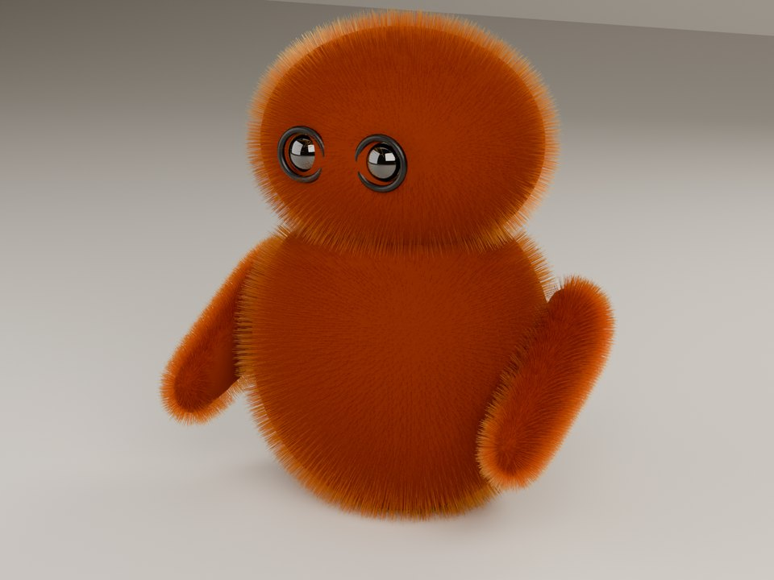
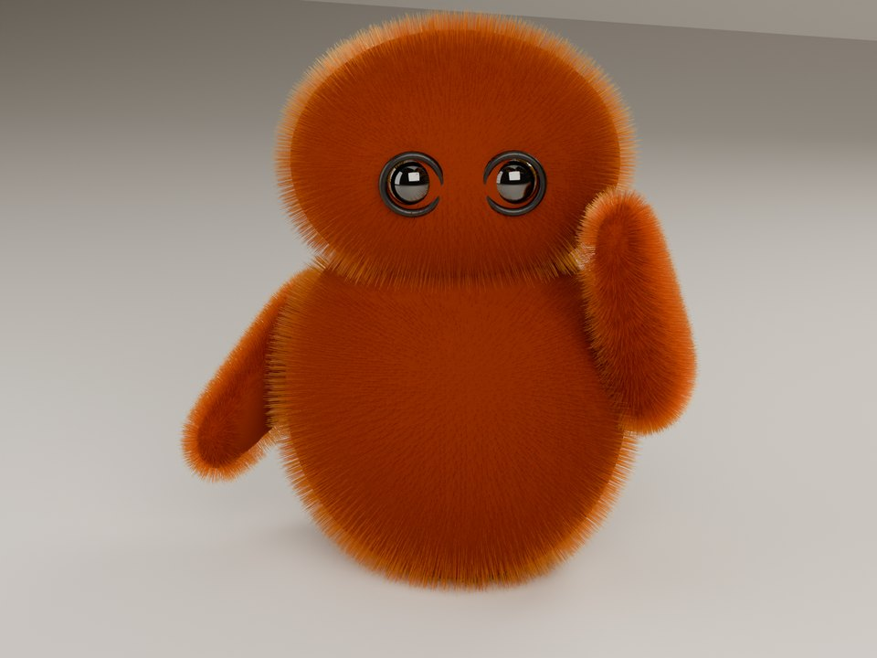
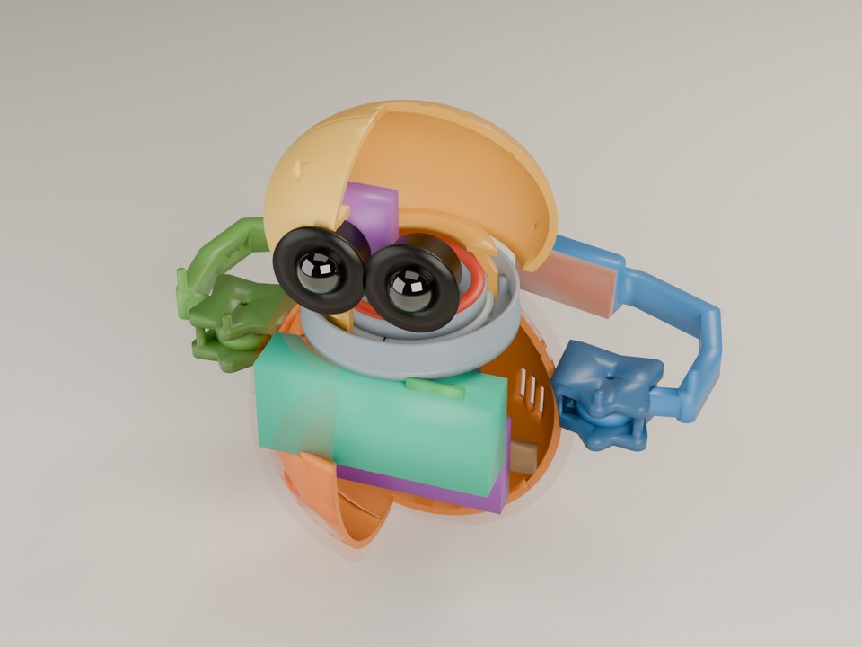
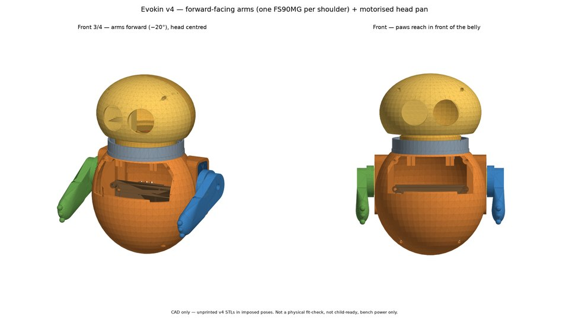
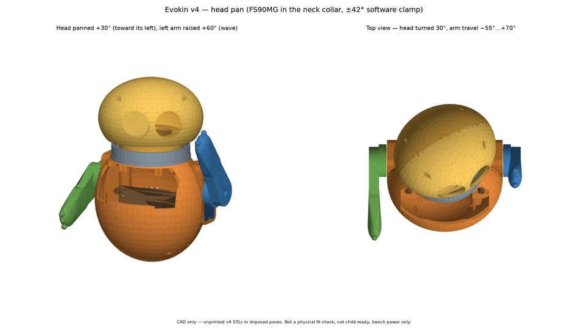
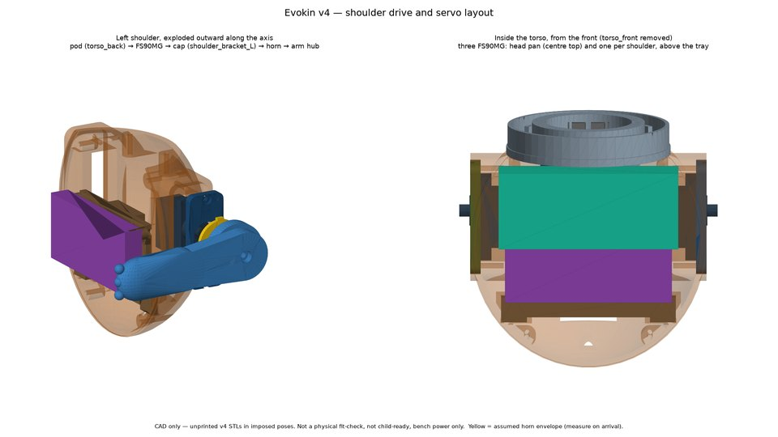

# Evokin

[](media/evokin_demo_ad_v3_real.mp4)

**[Watch the 10-second photoreal ad (MP4, 3.3 MB)](media/evokin_demo_ad_v3_real.mp4)** · [Mirumi-style take](media/evokin_demo_ad_v2.mp4) · [First hatch take](media/evokin_demo_ad.mp4)

Evokin is an open-source plush robot companion: a small orange, Mirumi-style bear whose head pans left and right and whose arms reach forward and up, for a hug or a wave. Inside the fur is a 3D-printed shell, three Feetech FS90MG servos (head pan, left arm, right arm) and a planned ESP32-S3 brain with a camera and a voice. This repository holds the v4 CAD, the printable STLs, the bill of materials and a short concept video.

The clip above is a **generated concept advertisement**, not footage of a built unit, and it still shows the **older v3 design** (backward clasping arms); it has not been regenerated for v4. The [Blender renders](#how-it-looks) and the CAD are the design source of truth. Nothing has been printed, assembled or purchased. The project is a bench prototype: not child-ready, not waterproof, and not a production kit.

## How it looks

Front 3/4, arms forward, from the v4 fur model in Blender:

[](renders/blender/01_hero_forward.png)

Head panned 30°, left arm raised in a wave:

[](renders/blender/02_hero_head30_wave.png)

Cutaway of the printed shell, yaw stack, shoulder servos and speaker:

[](renders/blender/03_cutaway.png)

CAD, front 3/4 and front (arms at the −20° rest pose):

[](renders/cad/v4_front34_assembly.png)

CAD, head panned +30° with the left arm at +60°:

[](renders/cad/v4_head30_wave.png)

Shoulder, exploded (pod in the back shell, FS90MG, cap, horn, arm hub):

[](renders/cad/v4_shoulder_exploded.png)

Full-resolution PNGs live in [`renders/blender/`](renders/blender/) and [`renders/cad/`](renders/cad/). The Blender scene is [`renders/blender/evokin_v4_fur.blend`](renders/blender/evokin_v4_fur.blend).

A slightly more polished landing page, with the video playing inline, is in [`docs/index.html`](docs/index.html) (intended for GitHub Pages served from `/docs`).

## How it works

Three metal-gear micro servos do all of the motion.

- **Head pan.** An FS90MG in the `yaw_collar` turns a coupler blade in a slot in the head (unchanged from v3). A printed 0.8 mm thrust washer takes the axial load. Software clamps pan to ±42°; the printed hard stop is at about ±47° so it is never a running face. Head tilt is **not** fitted: there is no clean room for a second head servo beside the camera and its ribbon loop in the 64 mm head.
- **Arms, direct drive.** One FS90MG per shoulder, case in a pod moulded into `torso_back`, held by a 4 mm `shoulder_bracket` cap (2 × M2.5). The horn sits in a pocket in the arm hub, with an axial M2.5×12 screw and two M2 horn screws. The arm swings about a left–right axis at y = 13, z = 60: 0° is straight forward, + is up. Software range is −55° (down and forward, paw 2.1 mm above the desk) to +70° (up, a wave); the STLs are exported at −20°.
- **Fail-safe** is a requirement, not a finished feature. Direct drive has **no mechanical breakaway**: if a child forces an arm, the servo gears take the load. The electronics plan is to cut the 5 V servo rail when the arms are parked, or when the INA219 sees a stall, so the servos can back-drive. Paw force at stall is about 3.4 N at the paw (2.2 kg·cm at 63 mm), from the datasheet, not measured.

The shells close on a male/female registration lip (0.25 mm FDM clearance) with one fastener scheme: M2.5 at 2.8 mm clearance / 2.1 mm pilot. Print the [`stl/coupon.stl`](stl/coupon.stl) test piece first if you print anything.

Naming: `arm_L` and `shoulder_bracket_L` are the **critter’s own left** (+x). Units are millimetres. The CAD frame is z up, −y face.

## Bill of materials

**Nothing has been bought.** Every price below is a planned or suggested figure in AUD, from November 2026 supplier quotes, and may be out of date. Fasteners, fur, foam, cord, a battery and filament are still unsourced. The full table, including unsourced lines and custom-board targets, is in [`BOM.csv`](BOM.csv).

### Priced mechanical (keep these)

| ID | Item | Qty | Unit | Line | Supplier |
|---|---|---:|---:|---:|---|
| M1 | Feetech FS90MG (head pan) | 1 | 7.40 | 7.40 | Core Electronics |
| M2 | Feetech FS90MG (left arm) | 1 | 7.40 | 7.40 | Core Electronics |
| M3 | Feetech FS90MG (right arm, new in v4) | 1 | 7.40 | 7.40 | Core Electronics |
| M13 | Adafruit 3351 mono enclosed speaker, 3 W 4 Ω | 1 | 8.95 | 8.95 | Core Electronics / [Adafruit](https://www.adafruit.com/product/3351) |
| | **Subtotal** | | | **31.15** | |

Official servo drawing: [`datasheets/FS90MG.pdf`](datasheets/FS90MG.pdf). The included M2.5×4 horn screw is too short for the yaw coupler — plan on an 8–10 mm M2.5 and measure the horn on arrival. Two M2.5×12 arm-hub screws, four M2 horn screws, sixteen M2.5 shell/cap screws, two M2 retainer screws, six servo-tab screws and the orange fur skin are on the BOM but **not yet sourced** and not priced.

### Electronics — pick one planned path

**Option A**, a project buy (one prototype brain plus spare modules for a later custom board): about **A$88.40** electronics, or **A$92.90** with an optional TP4056, or about **A$119.55** (A$124.05 with the TP4056) once the three priced servos and speaker are included.

| Item | Qty | Line AUD | Supplier |
|---|---:|---:|---|
| Seeed XIAO ESP32S3 Sense | 1 | 22.58 | DigiKey Australia ([Seeed](https://www.seeedstudio.com/XIAO-ESP32S3-Sense-p-5639.html)) |
| ESP32-S3-WROOM-1U-N16R8 | 4 | 43.92 | DigiKey Australia (free shipping on this line, about A$66.50 with the Sense) |
| MAX98357A breakout (clone) | 1 | 7.95 | AuscomTech |
| INA219 breakout (clone) | 1 | 7.00 | AuscomTech |
| XL6009 boost, set to 5 V | 1 | 6.95 | AuscomTech |
| TP4056 charger (optional) | 1 | 4.50 | MakerStore |

**Option B**, cheaper electronics but needs an extra servo driver: about **A$51.18** electronics, or about **A$82.33** with the priced servos and speaker, plus a PCA9685 servo driver (not yet sourced) and postage.

| Item | Qty | Line AUD | Supplier |
|---|---:|---:|---|
| DFRobot ESP32-S3 AI Camera DFR1154 (OV3660, PDM mic, MAX98357, no charger) | 1 | 37.23 | Core Electronics |
| INA219 breakout (clone) | 1 | 7.00 | AuscomTech |
| XL6009 boost, set to 5 V | 1 | 6.95 | AuscomTech |
| PCA9685 16-channel I2C servo driver | 1 | not yet sourced | — |

v4 needs **three** servo channels. Per the DFRobot wiki, the DFR1154 has only **GPIO43/44** free (the Gravity/UART port); the camera, PDM mic, amp, SD slot, IR LED, status LED and BOOT use the rest. So it **cannot drive three servos directly**. The plan is to run 43/44 as I2C to a PCA9685 servo driver (shared with the INA219). The XIAO ESP32S3 Sense does have enough: three servos, I2S amp and I2C INA219 use 8 of its 11 pins (D0–D10), leaving D8–D10 spare if the SD card is unused. The DFR1154 has no charger.

Name-brand alternatives at Core Electronics: MAX98357A A$10.65, INMP441 A$12.30, BQ24074 breakout A$28.25, Pololu S13V20F5 A$29.55, INA219 A$17.30.

A later **custom 65 × 55 mm 4-layer ESP32-S3 board** (WROOM-1-N16R8, BQ24074, TPS63020, TPS61088, INA219, TPS259241 eFuse, OV2640/OV3660, INMP441, MAX98357A) is estimated at about **A$120** at JLCPCB for two assembled boards plus three bare, and about **A$60** of local peripherals including a 2000 mAh LiPo. That board has not been designed. The 55 mm depth is larger than the current tray dummy and will need a fit check.

Cautions: prefer a protected 5 V regulator over an XL6009 or MT3608; many bare TP4056 boards have no protection IC; clone INMP441 modules are often fake; measure the real servo current before setting an INA219 trip threshold.

## STL files

[Download all STLs as a zip](docs/downloads/evokin-stls.zip) (about 1.1 MB). Printable parts live in [`stl/`](stl/). Fit dummies and fur/sleeve proxies are in [`stl/reference/`](stl/reference/) and are not printed for the robot.

FDM in PLA or PETG is the intended process. No layer height or infill has been validated; the coupon is the place to start. A passing coupon is **not** a full fit-check.

| Part | File | Material / print notes | Qty |
|---|---|---|---:|
| Torso front | [stl/torso_front.stl](stl/torso_front.stl) | FDM, PLA or PETG. Print seam-down (front face on the bed). 0.40 mm outer chamfer for elephant-foot. M2.5 clearance 2.8 mm. Female registration groove. | 1 |
| Torso back | [stl/torso_back.stl](stl/torso_back.stl) | Same. Male registration lip, 1.2 mm. M2.5 pilots 2.1 mm. **v4:** shoulder pods moulded in at both sides (FS90MG case pockets, cap rebate, 2.1 mm cap-screw pilots). | 1 |
| Tray | [stl/tray.stl](stl/tray.stl) | FDM. **v4:** clasp-servo shelf removed; 10 mm tabs at x = ±29, z = 23 into torso pockets. Amp pocket on the spine. | 1 |
| Yaw collar | [stl/yaw_collar.stl](stl/yaw_collar.stl) | FDM. Head-pan servo hangers, 1.7 mm pilots, stepped Ø34 bore for horn / coupler / ribbon from above. Unchanged. | 1 |
| Yaw retainer A | [stl/yaw_retainer_A.stl](stl/yaw_retainer_A.stl) | FDM. M2 clearance 2.3 mm. | 1 |
| Yaw retainer B | [stl/yaw_retainer_B.stl](stl/yaw_retainer_B.stl) | Pair with A. | 1 |
| Yaw coupler | [stl/yaw_coupler.stl](stl/yaw_coupler.stl) | FDM. 2.0 mm blade in a 2.7 mm head slot. Needs a longer M2.5 horn screw. | 1 |
| Yaw thrust washer | [stl/yaw_thrust_washer.stl](stl/yaw_thrust_washer.stl) | FDM, 0.8 mm. Print flat on the bed, no supports. ID 35, OD 43. | 1 |
| Head front | [stl/head_front.stl](stl/head_front.stl) | FDM. Same lip/groove and M2.5 scheme as the torso. Camera and bezel seats. Unchanged. | 1 |
| Head back | [stl/head_back.stl](stl/head_back.stl) | FDM. Print skirt-down. Underside is a 30°-from-vertical cone so a 35° support threshold should not land supports on a flat thrust face — the flat face is the washer. Unchanged. | 1 |
| Arm L (critter’s left, +x) | [stl/arm_L.stl](stl/arm_L.stl) | FDM. **v4:** new forward-reaching arm with a Ø26 hub (horn pocket, Ø5.5 spline pocket, M2.5×12 axial screw, 2 × 1.7 mm horn pilots). Exported at −20°. Print on its flat outer face. | 1 |
| Arm R (critter’s right, −x) | [stl/arm_R.stl](stl/arm_R.stl) | FDM. Mirror of arm L. | 1 |
| Shoulder cap L | [stl/shoulder_bracket_L.stl](stl/shoulder_bracket_L.stl) | FDM, 4 mm plate. **v4:** now a cap over the arm-servo pod; servo tabs screw into it (1.7 mm pilots), 2 × M2.5 (2.8 mm) into the pod. | 1 |
| Shoulder cap R | [stl/shoulder_bracket_R.stl](stl/shoulder_bracket_R.stl) | FDM. Mirror of L. | 1 |
| Eye bezel | [stl/bezel.stl](stl/bezel.stl) | FDM. Single bezel; print two (left and right are mirrors in the assembly). | 2 |
| Shutter | [stl/shutter.stl](stl/shutter.stl) | FDM. Camera shutter. | 1 |
| Test coupon (optional) | [stl/coupon.stl](stl/coupon.stl) | Print this first. Journal + skirt, washer, tab/pocket, FS90MG seat. | 1 |

Removed in v4: `clasp_drum.stl`, the paw-pad foam templates, the clasp servo/horn dummies and `strap_env.stl`.

## Electronics overview

The planned brain is an **ESP32-S3**, not the Raspberry Pi Zero that the tray dummy still describes. v4 needs **three servo PWM channels** (head pan, left arm, right arm). Two first-article paths are shortlisted above; a custom 65 × 55 mm board is a later target. See [`electronics/esp32-board-notes.md`](electronics/esp32-board-notes.md) for the block diagram, GPIO cautions, bring-up checklist and CAD-fit notes.

In short:

- Brain: XIAO ESP32S3 Sense, or DFRobot DFR1154, or a WROOM-1-N16R8 custom board (16 MB flash, 8 MB Octal PSRAM).
- Camera: OV2640 or OV3660 on a 24-pin FPC, as a loose U-bend through the neck — do not twist the ribbon around the yaw axis. On N16R8 modules, do not use GPIO 33–37.
- Audio: MAX98357A into the Adafruit 3351; I2S/PDM mic onboard or INMP441.
- Power: a 5 V servo rail separate from 3.3 V, with bulk capacitance. Prefer BQ24074 over a bare TP4056, and TPS61088 (or a protected module) over MT3608 / a bare XL6009.
- Servos: 3 × FS90MG, up to 2.4 A if all stall at once (3 × 0.8 A at 6 V). XIAO: three spare LEDC PWM pins confirmed. DFR1154: only GPIO43/44 free, so add a PCA9685 over I2C.
- Fail-safe: INA219 on the servo rail plus an eFuse or load switch. Measure the real servo current before setting a trip.

## Build notes

CAD only. Do not treat these STLs as a fit-check or a print-ready kit.

1. Print `stl/coupon.stl` first and check the journal running fit, the tab/pocket and the FS90MG seat.
2. **Arm servos (each side).** Centre the servo electrically first. On the bench, screw the FS90MG tabs to the `shoulder_bracket` cap (self-tappers into the 1.7 mm pilots). Drop the servo into the pod in `torso_back` from outside, cap into its rebate, 2 × M2.5 into the pod. Press the horn on at the angle for arm −20°, screw the arm hub to the horn (2 × M2), then the M2.5×12 axial screw through the hub into the spline.
3. **Tray.** Slide the tray tabs into the torso pockets and close the shells.
4. **Head pan.** Drop the pan FS90MG into the collar hangers from below; self-tappers from below. Screw the collar onto the torso (M2.5 clearance in the collar, pilots in the torso). From above, through the Ø34 bore: horn, coupler, longer M2.5 horn screw. Drop the thrust washer onto the journal. Lower the head; retainers go in from the side into 1.7 mm pilots in the skirt.
5. Close the torso and head shells on the registration lip; M2.5 from the front (2.8 mm) into the back (2.1 mm pilots).
6. Keep the first electrical bring-up on a bench supply, with firmware clamps of ±42° (head) and −55°…+70° (arms) in place before the servos are powered. Portable power is unresolved.

Detailed seats, clearances and FS90MG drawing flags are in [`cad/README.md`](cad/README.md). Rebuild from the OpenSCAD sources with:

```bash
# from the repository root; needs OpenSCAD 2021.01+ and, for the audits, Python 3 with trimesh
EXPORT_CHECK=1 bash scripts/build_stl.sh
python3 scripts/sim_v4.py          # dense imposed-motion sweep, a few minutes
python3 scripts/fit_audit.py
python3 scripts/metrics_v4.py
python3 scripts/render_v4.py
# or all of the above: bash scripts/run_all.sh
# Blender fur renders: blender -b -P scripts/render_blender.py -- --final
```

Set `OPENSCAD=/path/to/openscad` if it is not on your `PATH`. `EXPORT_CHECK=1 bash scripts/build_stl.sh` also writes posed intermediates to `check/` for the sweep (those files are not checked in).

## Validation (CAD only)

The v4 audit is measurements and an imposed-motion collision sweep on the exported STLs. **Nothing has been printed or physically tested.** Summary from [`results/validation_summary.json`](results/validation_summary.json):

| Check | Result |
|---|---|
| Fit-audit interfaces | **21 / 21 pass**, 0 marginal, 0 fail |
| Imposed-motion sweep | 1,017 poses (head −48…+48°, each arm −80…+85°, plus a head × arm × arm grid), 245,097 pair tests, 22,712 booleans |
| Rigid overlaps in travel | **0** (arms −55…+70°, head ±42°) |
| Head pan hard stop | collar ↔ head contact at ±47°, 5° beyond the ±42° software clamp |
| Arm clearances in travel | 0.6 mm to the shell and cap, 10.6 mm to the head, sleeve fur 0.58 mm off the torso fur; paw ≥ 2.1 mm above the desk |
| Pose transforms | posed STLs match the sweep's transforms to 0.0005 mm |
| Printable meshes | Watertight |
| Load (datasheet, not measured) | arm gravity torque 2.1 % of FS90MG stall; head pan accel. 6.7 % of stall for 60° in 0.12 s |

The 21 interfaces cover all three FS90MG seats, the arm hub / horn / cap clearance, the head pan joint and neck cable path, arm travel, torso and head seams, the yaw journal, thrust washer, retainers, coupler blade, tray tab pockets, speaker / amp / mic seats, the camera ribbon path, the board envelope, the test coupon, and mesh watertightness. Full tables: [`results/fit_audit_table.csv`](results/fit_audit_table.csv), [`results/fit_audit.json`](results/fit_audit.json), [`results/summary_sweep.json`](results/summary_sweep.json), [`results/metrics_v4.json`](results/metrics_v4.json).

## Changelog

### v4 — forward-facing arms, motorised head pan

- **Arms now face forward** and swing forward/up (hug or wave) instead of clasping backward around a strap. Each arm has its own FS90MG, direct drive; the clasp servo, cord drum, return elastic, pull-pin axles and foam paw pads are gone.
- **Third FS90MG** added (BOM M3, A$7.40, planned, not purchased). New unsourced fasteners: 2 × M2.5×12 hub screws, 4 × M2 horn screws.
- `torso_back` gains two shoulder pods; `shoulder_bracket_L/R` are now 4 mm caps over them; `tray` loses the clasp shelf and its tabs move; `torso_front` fastener and vent positions follow.
- **Head pan** kept from v3 (FS90MG in the collar, ±42° software, ±47° hard stop) and now covered by explicit fit-audit rows. Tilt is not fitted.
- **Ears:** the model has none (the side shapes in earlier renders were the arms), so nothing to turn.
- Electronics: three servo channels. DFR1154 needs a PCA9685; the XIAO ESP32S3 Sense has spare PWM pins.
- Validation re-run: 21/21 fit audit, 0 rigid overlaps in a 1,017-pose sweep.
- Concept videos **not** regenerated; they still show v3.

## Status

- **Prototype, CAD complete for v4.** Unprinted. Motion, arm force, fail-safe behaviour and wear are untested.
- **Nothing has been ordered or purchased.** The electronics lines are a shortlist only.
- Power is bench-tethered only. Portable power is unresolved.
- Direct-drive arms have no mechanical breakaway; protection relies on a current trip that is not built.
- Horn size, tooth count (drawing says 20T; some Feetech pages say 21T), horn screw radius and the included screws must be measured on arrival.
- The concept videos show the older v3 design.
- **Not production, not child-ready, not waterproof.**

## Licence

Everything in this repository (CAD, STLs, BOM, renders, documentation and scripts) is licensed under the [MIT License](LICENSE).

The clips in `media/` are generated concept videos, not footage of a built unit.

## Repository layout

```
README.md                 This page
BOM.csv                   Full mechanical + electronics bill of materials
cad/                      OpenSCAD source (critter_v4.scad) and the engineering note
stl/                      Printable parts, plus reference/ dummies and proxies
scripts/                  Export, fit audit, sweep, metrics, renders
renders/                  Blender heroes, CAD stills, web-sized previews
media/                    Concept videos and the README GIF preview
electronics/              ESP32-S3 planning notes
datasheets/               Official FS90MG drawing
results/                  v4 validation JSON/CSV
docs/                     GitHub Pages landing page (serve from /docs)
```
