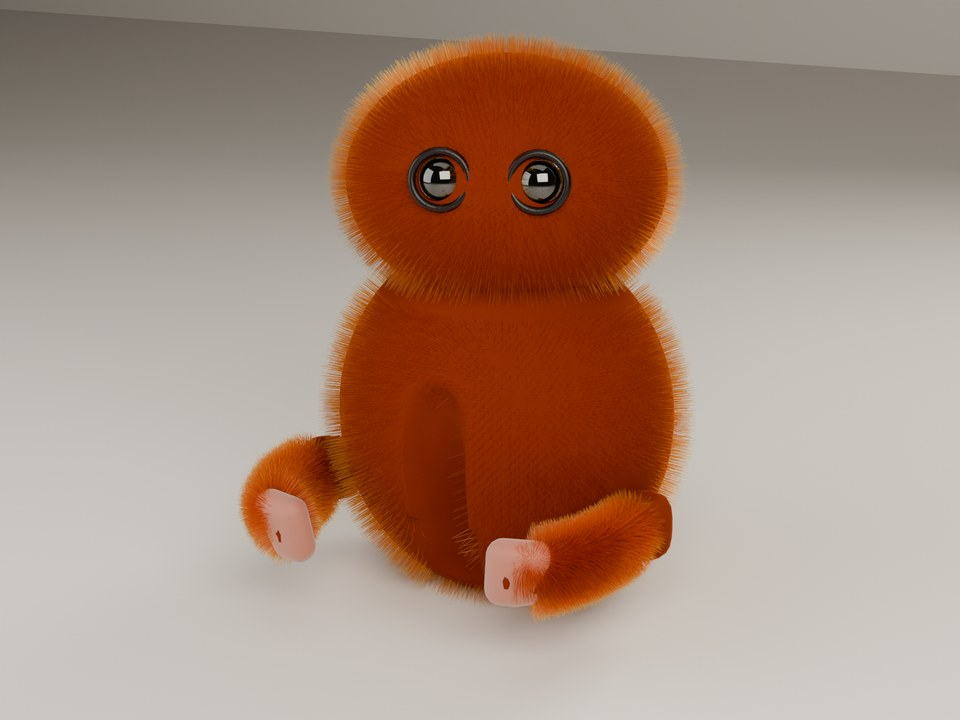
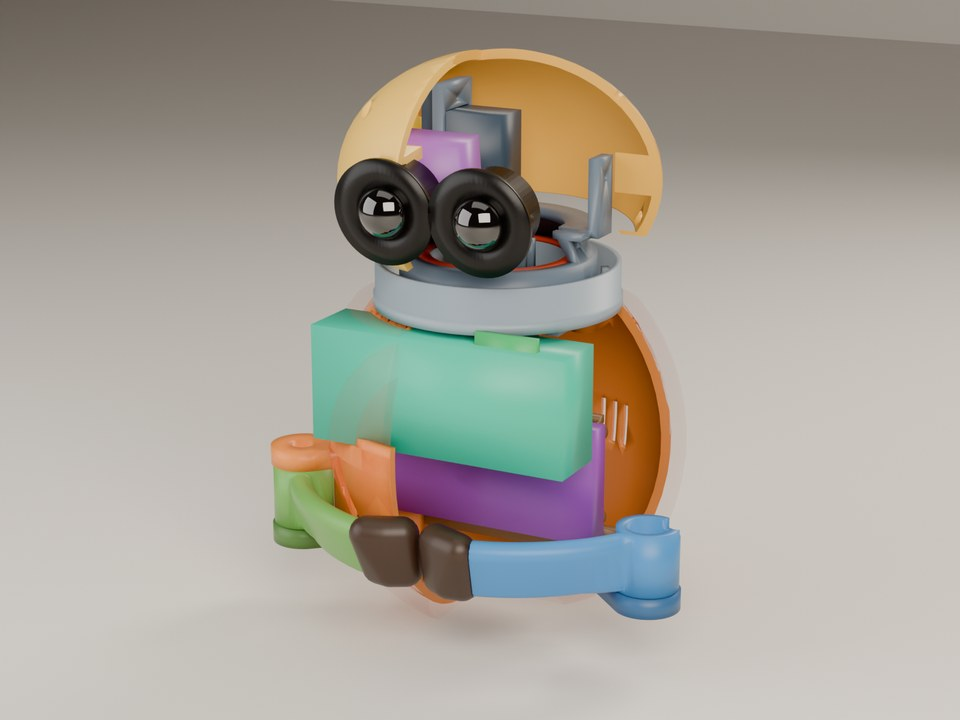
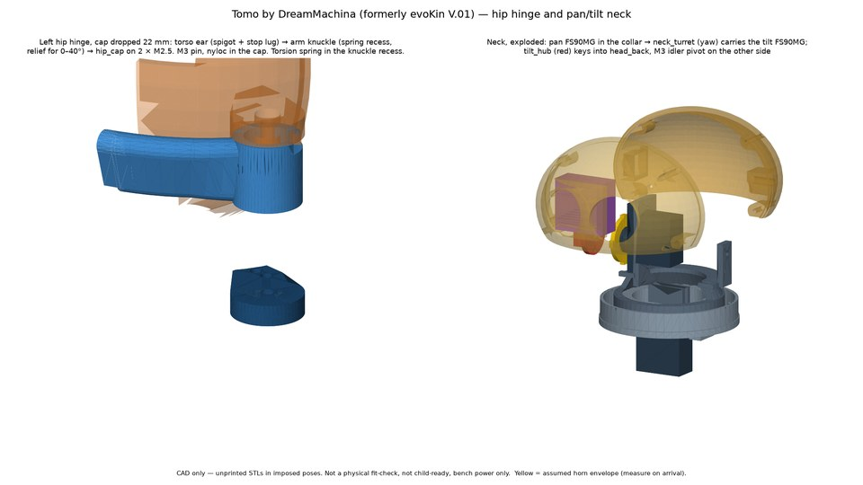

# Tomo by DreamMachina (formerly evoKin V.01)

[](media/evokin_demo_ad_v3_real.mp4)

**[Watch the 10-second photoreal ad (MP4, 3.3 MB)](media/evokin_demo_ad_v3_real.mp4)** · [Mirumi-style take](media/evokin_demo_ad_v2.mp4) · [First hatch take](media/evokin_demo_ad.mp4)

Tomo is an open-source plush robot companion: a small orange, Mirumi-style bear that **hugs** a bag strap or handle with spring-loaded arms, and looks around, nods and turns away shyly with a two-servo head. Inside the fur is a 3D-printed shell, two Feetech FS90MG servos (head pan and head tilt), two small torsion springs for the arms, and a planned ESP32-S3 brain with a camera and a voice. This repository holds the V.01 CAD, the printable STLs, the bill of materials, a head-motion firmware sketch and the concept renders.

Repository: [github.com/Hewlbern/Tomo](https://github.com/Hewlbern/Tomo) · Landing page: [hewlbern.github.io/Tomo](https://hewlbern.github.io/Tomo/)

> **The videos show an older design.** The clips above are generated concept advertisements, not footage of a built unit, and they still show the v3 design (arms clasping backward around a strap). They have not been regenerated for the passive hug. The [renders](#how-it-looks) and the CAD are the design source of truth. Nothing has been printed, assembled or purchased. Tomo is a bench prototype: not child-ready, not waterproof and not a production kit.

## How it looks

Hanging from a Ø12.5 mm round bag handle: the handle lies in the belly groove and the paws close on it under spring force (Blender fur model):

[](renders/blender/01_hero_hug_handle.png)

Arms pulled open by hand to the 40° stop, head panned 20° and looking up:

[](renders/blender/02_arms_open.png)

Cutaway: hip hinges, groove, neck turret with the tilt servo, speaker and board, head nodding 8°:

[](renders/blender/03_cutaway_hinge_tilt.png)

CAD, hugging a Ø12.5 handle (front 3/4, and a section at the arms):

[](renders/cad/v01_hug_handle.png)

CAD, arms open with the head panned and looking up, and nodding 10°:

[](renders/cad/v01_arms_open_tilt.png)

CAD, hip hinge and pan/tilt neck exploded:

[](renders/cad/v01_hip_turret_exploded.png)

Full-resolution PNGs live in [`renders/blender/`](renders/blender/) and [`renders/cad/`](renders/cad/). The Blender scene is [`renders/blender/evokin_v01_fur.blend`](renders/blender/evokin_v01_fur.blend). A landing page with the video inline is in [`docs/index.html`](docs/index.html), served by GitHub Pages at [hewlbern.github.io/Tomo](https://hewlbern.github.io/Tomo/).

## How it works

### Passive spring hug (Mirumi-style)

- **Hinge.** Each arm is a curved band that follows the belly at an 8.5 mm offset and ends in a paw that curls in towards the middle. It turns on a **vertical M3 pin** at the hip (x = ±49.95, y = −16.19). The pin runs through an ear moulded into `torso_front` above, the arm's Ø16 knuckle (z 22–38) and a screwed-on `hip_cap` below (2 × M2.5, M3 nyloc in a hex trap). The arm, spring and pin come out without opening the torso.
- **Spring.** A music-wire **torsion spring** sits in a Ø11 recess in each knuckle: 0.048 in (1.22 mm) wire, 3/8 in OD, 90° legs — catalogue part Approved Vendor / Grainger **3HPG6 (left-hand)** and **3HPD1 (right-hand)**, rated 2.679 lbf·in (302.7 N·mm) at 90°, so **3.36 N·mm per degree**. It is preloaded **35°** at the closed stop, and winds to 75° at the open stop, inside its 90° rating.
- **Stops.** A printed lug on the torso ear runs in a 64° relief in the top of the knuckle: the arm rests closed at 0° and opens to a hard stop at **40°**. Zero power holds the hug; you open the arms by hand (about 5 N at each paw at full open) and let go.
- **Belly groove.** A rounded R8 channel runs down the front of the torso from z = 12 to 62 mm with a 2.4 mm liner. Its floor **leans 14°** (y = −30 − 0.25·(z − 30)) so a straight strap clears the upper belly and the speaker grille. It takes round straps and handles **Ø10–15 mm**, and a flat strap up to **25 × 2.5 mm** laid across it.
- **Paws.** 1.5 mm **TPU pads** (`paw_pad_L/R`) on the inner paws take the squash and give the grip its friction; the rigid arm stays about 1.5 mm clear of the object. With the arms on the open stop there is **28 mm** between pad and belly (54 mm tip to tip), so a Ø15 handle slides straight in.

**Clamp force (catalogue spring rate, not measured).** Force at each paw = spring torque ÷ the lever from the hinge axis to the pad contact (≈51 mm):

| Object in the groove | Arm opens | Spring torque | Force per paw | Push into the groove |
|---|---:|---:|---:|---:|
| Ø10 round | 1.9° | 124 N·mm | **2.4 N** | 3.7 N |
| Ø12.5 round | 4.4° | 133 N·mm | **2.6 N** | 3.7 N |
| Ø15 round | 6.8° | 141 N·mm | **2.8 N** | 3.7 N |
| Flat strap 25 × 2.5 | 2.6° | 127 N·mm | **2.9 N** (lever 44 mm) | 5.8 N |

Assumptions: linear catalogue rate, no hinge friction, rigid TPU for the angle (real pads add about 1 mm of squash, so slightly more force). **Hanging check:** the robot is about 263 g, so it hangs leaning back 14° along the groove with its centre of mass about 41 mm behind the strap. Carrying that moment needs about 3.9 N at the paws against 5.2 N available, and with μ ≈ 0.5 (TPU and fur on fabric, assumed) friction gives a slip safety factor of about 3.5 (3.3 with a 2000 mAh battery). On paper it holds; real straps and fur will decide.

### Head: pan and tilt (2 × FS90MG)

- **Pan.** An FS90MG in the `yaw_collar` turns a coupler blade in a slot (as in v3). The slot, skirt, cone, retainers and pan stop now live on a new **`neck_turret`** that carries the tilt servo. Software clamps pan to ±42°; the printed hard stop is at ±47°.
- **Tilt / nod (new).** A second FS90MG lies across the turret with its spline on a tilt axis along x through y = 6, z = 119, close to the head's centre so the shell barely moves. A printed `tilt_hub` on the horn keys into `head_back`; an M3 idler screw is the bearing on the other side. Software clamps tilt to **±10°**; the first rigid contact is at +12° nodding down and −15.5° looking up. The head shell now starts 2.5 mm higher and the front of the turret deck is cut away so the chin and camera clear.
- **Cables.** The pan servo's lead never crosses a moving joint. The tilt servo rides on the turret, so its lead crosses the pan joint and needs a ≥40 mm service loop down the Ø34 collar bore, tied to the camera FPC. The FPC loop bay sits close to the tilt axis, so ±10° moves it only about ±3 mm.

### Firmware

[`firmware/evokin_v01/evokin_v01.ino`](firmware/evokin_v01/evokin_v01.ino) (ESP32Servo, XIAO ESP32S3, pan on D0, tilt on D1) has three behaviours — **look-around**, **nod** and a **shy turn-away** — with eased moves, the ±42° / ±10° clamps, and a limp mode between moves. The clasp logic and arm interlock of the servo-clasp design are gone: the arms need no firmware. Untested.

The shells close on a male/female registration lip (0.25 mm FDM clearance) with one fastener scheme: M2.5 at 2.8 mm clearance / 2.1 mm pilot. Print [`stl/coupon.stl`](stl/coupon.stl) first if you print anything.

Naming: `arm_L` and `hip_cap_L` are the **critter's own left** (+x). Units are millimetres; the CAD frame is z up, −y face. Internal file names keep the `evokin_` prefix so the build pipeline is unchanged.

## Trade-offs

- **Passive arms cannot move on their own.** No wave, no motorised hug: a person opens the arms and the spring closes them. In exchange there is no arm current, no gear train to strip, nothing to back-drive and no grip interlock.
- **Grip is modest and fixed.** About 2.4–2.9 N per paw, set by the spring. Thicker handles grip a little harder; a stronger spring raises it but makes the arms harder for small hands to open. Spring price is uncertain (see the BOM).
- **The paws are still a (soft) pinch point**, at about 2.5 N. Fingers can be pulled out; the arms open by hand.
- **Strap fit.** Round Ø10–15 mm and flat up to 25 mm. Thinner cords may slip; thicker handles will not fit the groove. The strap leans 14° on the body, so Tomo hangs leaning back.
- **Heavier than Mirumi.** About 263 g (310 g solid upper bound, 301 g with a 2000 mAh battery) against Mirumi's 155 g, because Tomo is bigger and carries a speaker and a camera brain.
- **Tilt is tight.** Only 2° between the ±10° clamp and the first contact when nodding down; keep the firmware clamp. Pan now also swings the turret and the tilt servo (5.4 % of stall for 60° in 0.12 s).
- **One more lead crosses the neck** (the tilt servo's), alongside the camera FPC.

## Bill of materials

**Nothing has been bought.** Every price below is a planned or shortlisted figure in AUD, from November 2026 supplier quotes, and may be out of date. Fasteners, springs, fur, a battery and filament are not in the totals. The full table is in [`BOM.csv`](BOM.csv).

### Priced mechanical

| ID | Item | Qty | Unit | Line | Supplier |
|---|---|---:|---:|---:|---|
| M1 | Feetech FS90MG (head pan) | 1 | 7.40 | 7.40 | Core Electronics |
| M2 | Feetech FS90MG (head tilt / nod) | 1 | 7.40 | 7.40 | Core Electronics |
| M17 | Adafruit 3351 mono enclosed speaker, 3 W 4 Ω | 1 | 8.95 | 8.95 | Core Electronics / [Adafruit](https://www.adafruit.com/product/3351) |
| | **Subtotal** | | | **23.75** | (was 31.15 with three servos) |

### Springs and fasteners (planned, not in the totals)

| ID | Item | Qty | Note |
|---|---|---:|---|
| M3 | Torsion spring, left-hand, Grainger 3HPG6 (6-pack) | 1 pack | **Price uncertain:** Raptor Supplies AU showed A$16.98 per pack on a category page and about A$108–109 on the product page (Nov 2026). Confirm before ordering. |
| M4 | Torsion spring, right-hand, Grainger 3HPD1 (6-pack) | 1 pack | Same. One spring per hip; the rest are spares for tuning. |
| M5 | M3 × ~30 hinge-pin screw + M3 nyloc | 2 + 2 | Confirm length on the printed stack. |
| M6 | M2.5 × 8, hip caps | 4 | |
| M7–M12 | Longer M2.5 horn screws (2), M2 hub/key screws (3), M3 tilt idler screw (1), M2.5 shell/collar screws (12), M2 retainer screws (2), servo-tab screws (4) | | Not sourced. Measure the horns on arrival. |
| M13 | Orange fur skin with a belly-groove slit and hip openings | 1 | Not sourced. |
| M14 | TPU paw pads (printed) | 2 | 85A–95A. |

Official servo drawing: [`datasheets/FS90MG.pdf`](datasheets/FS90MG.pdf). Removed with the servo clasp: the two arm FS90MGs, the M2.5×12 arm-hub screws, the arm horn screws and the shoulder caps.

### Electronics — pick one planned path

**Option A**, a project buy (one prototype brain plus spare modules for a later custom board): **A$88.40** electronics, A$92.90 with an optional TP4056, or **A$112.15** (A$116.65 with the TP4056) with the two servos and speaker.

| Item | Qty | Line AUD | Supplier |
|---|---:|---:|---|
| Seeed XIAO ESP32S3 Sense | 1 | 22.58 | DigiKey Australia ([Seeed](https://www.seeedstudio.com/XIAO-ESP32S3-Sense-p-5639.html)) |
| ESP32-S3-WROOM-1U-N16R8 | 4 | 43.92 | DigiKey Australia (free shipping on this line, about A$66.50 with the Sense) |
| MAX98357A breakout (clone) | 1 | 7.95 | AuscomTech |
| INA219 breakout (clone) | 1 | 7.00 | AuscomTech |
| XL6009 boost, set to 5 V | 1 | 6.95 | AuscomTech |
| TP4056 charger (optional) | 1 | 4.50 | MakerStore |

**Option B**, cheaper electronics but needs a servo driver: **A$51.18** electronics, or **A$74.93** with the two servos and speaker, plus a PCA9685 (not yet sourced) and postage.

| Item | Qty | Line AUD | Supplier |
|---|---:|---:|---|
| DFRobot ESP32-S3 AI Camera DFR1154 (OV3660, PDM mic, MAX98357, no charger) | 1 | 37.23 | Core Electronics |
| INA219 breakout (clone) | 1 | 7.00 | AuscomTech |
| XL6009 boost, set to 5 V | 1 | 6.95 | AuscomTech |
| PCA9685 16-channel I2C servo driver | 1 | not yet sourced | — |

The DFR1154 has only GPIO43/44 free; they could drive the two head servos directly but then nothing is left for the INA219, so the plan is still I2C to a PCA9685 shared with the INA219. The XIAO ESP32S3 Sense has plenty: pan D0, tilt D1, I2S amp D3/D6/D7, INA219 D4/D5. Name-brand alternatives at Core Electronics: MAX98357A A$10.65, INMP441 A$12.30, BQ24074 breakout A$28.25, Pololu S13V20F5 A$29.55, INA219 A$17.30.

A later **custom 65 × 55 mm 4-layer ESP32-S3 board** is estimated at about **A$120** at JLCPCB for two assembled boards plus three bare, plus about **A$60** of local peripherals. It has not been designed.

Cautions: prefer a protected 5 V regulator over an XL6009 or MT3608; many bare TP4056 boards have no protection IC; clone INMP441 modules are often fake; measure the real servo current before setting an INA219 trip threshold.

## STL files

[Download all STLs as a zip](docs/downloads/evokin-stls.zip). Printable parts live in [`stl/`](stl/). Fit dummies, fur/sleeve proxies and the Ø12.5 test rod are in [`stl/reference/`](stl/reference/) and are not printed for the robot. All parts are exported in the assembled pose (head centred, arms closed).

FDM in PLA or PETG is the intended process; no layer height or infill has been validated.

| Part | File | Material / print notes | Qty |
|---|---|---|---:|
| Torso front | [stl/torso_front.stl](stl/torso_front.stl) | FDM, PLA or PETG. **New:** belly groove with a 2.4 mm liner, hip webs and upper ears (Ø5.9 spring spigot, stop lug) both sides. Female registration groove, M2.5 clearance 2.8 mm. | 1 |
| Torso back | [stl/torso_back.stl](stl/torso_back.stl) | Same. Male registration lip. **New:** shoulder servo pods removed. | 1 |
| Tray | [stl/tray.stl](stl/tray.stl) | FDM. Unchanged. | 1 |
| Yaw collar | [stl/yaw_collar.stl](stl/yaw_collar.stl) | FDM. Pan-servo hangers. Unchanged. | 1 |
| Yaw retainers A / B | [A](stl/yaw_retainer_A.stl) · [B](stl/yaw_retainer_B.stl) | FDM. M2 clearance 2.3 mm, screw into the turret skirt. | 1 + 1 |
| Yaw coupler | [stl/yaw_coupler.stl](stl/yaw_coupler.stl) | FDM. 2.0 mm blade in the turret's 2.7 mm slot. | 1 |
| Yaw thrust washer | [stl/yaw_thrust_washer.stl](stl/yaw_thrust_washer.stl) | FDM, 0.8 mm, flat on the bed. | 1 |
| Neck turret | [stl/neck_turret.stl](stl/neck_turret.stl) | **New.** Skirt, cone, coupler slot and pan stop (from the old head_back) plus the tilt-servo cradle and idler column. Print skirt-down. | 1 |
| Tilt hub | [stl/tilt_hub.stl](stl/tilt_hub.stl) | **New.** Ø18 disc on the tilt horn (2 × M2), 10 × 10 key into head_back. | 1 |
| Head front | [stl/head_front.stl](stl/head_front.stl) | FDM. Camera and bezel seats. Shell starts at z = 103.5; seam bosses moved. | 1 |
| Head back | [stl/head_back.stl](stl/head_back.stl) | FDM. **Changed:** tilt-hub socket and idler boss; skirt and slot moved to the turret. | 1 |
| Arm L / R | [L](stl/arm_L.stl) · [R](stl/arm_R.stl) | FDM, PETG preferred. **New:** curved hug band with the hip knuckle (spring recess, stop relief, Ø3.4 pin bore). Print lying flat so layers follow the band. | 1 + 1 |
| Hip cap L / R | [L](stl/hip_cap_L.stl) · [R](stl/hip_cap_R.stl) | **New.** 2 × M2.5 to the hip web, M3 nyloc trap. | 1 + 1 |
| Paw pad L / R | [L](stl/paw_pad_L.stl) · [R](stl/paw_pad_R.stl) | **New.** TPU 85A–95A, 1.5 mm. | 1 + 1 |
| Eye bezel | [stl/bezel.stl](stl/bezel.stl) | FDM. Print two. | 2 |
| Shutter | [stl/shutter.stl](stl/shutter.stl) | FDM. Camera shutter. | 1 |
| Test coupon (optional) | [stl/coupon.stl](stl/coupon.stl) | Print this first. | 1 |

Removed: `shoulder_bracket_L/R` and the arm-servo / arm-horn dummies.

## Electronics overview

The planned brain is an **ESP32-S3**, not the Raspberry Pi Zero the tray dummy still describes. V.01 needs **two servo PWM channels** (head pan, head tilt); the arms need none. See [`electronics/esp32-board-notes.md`](electronics/esp32-board-notes.md) for the block diagram, GPIO cautions, bring-up checklist and CAD-fit notes.

- Servos: 2 × FS90MG, up to 1.6 A if both stall (2 × 0.8 A at 6 V). Holding a hug costs no power.
- Fail-safe: INA219 on the servo rail plus an eFuse or load switch, so the head goes limp if forced. There is no grip current to cap.
- Camera FPC and the tilt servo lead cross the pan joint as loose loops; do not twist the FPC around the yaw axis.

## Build notes

CAD only. Do not treat these STLs as a fit-check or a print-ready kit.

1. Print `stl/coupon.stl` first and check the journal running fit, the tab/pocket and the FS90MG seat.
2. **Hips (each side).** Fit the torsion spring into the knuckle recess, its arm-side leg in the slot. Offer the knuckle up under the torso ear so the spring's body goes over the Ø5.9 spigot, wind the arm 35° open, and hook the torso-side leg. Screw the `hip_cap` on (2 × M2.5), drop the M3 pin from the top and nyloc it underneath; snug, not tight, so the arm swings freely. Press on the TPU paw pad.
3. **Tray.** Slide the tray tabs into the torso pockets and close the shells.
4. **Head pan.** Pan FS90MG into the collar hangers from below; collar onto the torso. From above: horn, coupler, longer M2.5 horn screw, thrust washer. Lower the `neck_turret` over the journal; retainers into the skirt.
5. **Head tilt.** Screw the tilt FS90MG to the turret cradle (tabs on its −x face). Centre it electrically, fit the horn and the `tilt_hub` (2 × M2). Hang `head_back` on the hub key and the M3 idler screw, then close `head_front` (M2.5).
6. Bring-up on a current-limited bench supply, with the firmware clamps (pan ±42°, tilt ±10°) in place and the centre trims set before the head is fitted. Portable power is unresolved.

Detailed seats, clearances and FS90MG drawing flags are in [`cad/README.md`](cad/README.md). Rebuild with:

```bash
# from the repository root; needs OpenSCAD 2021.01+ and Python 3 with trimesh (manifold3d for booleans)
EXPORT_CHECK=1 bash scripts/build_stl.sh
python3 scripts/sim_v01.py         # imposed-motion sweep + hug checks, about 2 minutes
python3 scripts/fit_audit.py
python3 scripts/metrics_v01.py
python3 scripts/validation_summary.py
python3 scripts/render_v01.py
# or all of the above: bash scripts/run_all.sh
# Blender fur renders: blender -b -P scripts/render_blender.py -- --final
```

Set `OPENSCAD=/path/to/openscad` if it is not on your `PATH`.

## Validation (CAD only)

Measurements and an imposed-motion collision sweep on the exported STLs. **Nothing has been printed or physically tested.** Summary from [`results/validation_summary.json`](results/validation_summary.json):

| Check | Result |
|---|---|
| Fit-audit interfaces | **25 / 25 pass**, 0 marginal, 0 fail |
| Imposed-motion sweep | 457 poses (pan −50…+50°, tilt −25…+25°, each arm −5…+50°, and a pan × tilt × arm × arm grid), 147,154 pair tests, 15,815 booleans |
| Rigid overlaps in travel | **0** (pan ±42°, tilt ±10°, arms 0–40°) |
| Arm stops | engage at −0.5° (closed) and 40.5° (open); arm ↔ hip cap 0.4 mm; closed pad ↔ shell 1.04 mm |
| Hug on Ø10 / 12.5 / 15 round | arms open 1.9° / 4.4° / 6.8°; 2.4 / 2.6 / 2.8 N per paw; rigid arm ≈1.5 mm clear of the object |
| Hug on a 25 × 2.5 flat strap | arms open 2.6°; 2.9 N per paw |
| Arms open | pad ↔ belly 28.3 mm (spec ≥ 20), tip ↔ tip 54 mm; a Ø15 rod slides in without touching the arms |
| Head pan hard stop | collar ↔ turret at ±47°, 5° beyond the clamp |
| Head tilt | first contact +12° (head rim on the collar) and −15.5° (head_back on the turret); at ±12° turret clearance 0.6 mm, camera ↔ tilt servo ≥ 4.9 mm |
| Mass (estimate) | ≈263 g, centre of mass (−1.0, −4.6, 70.2) mm |
| Loads (datasheet) | tilt gravity 1.7 % of FS90MG stall; pan accel. 5.4 % of stall for 60° in 0.12 s |
| Printable meshes | Watertight |

Full tables: [`results/fit_audit_table.csv`](results/fit_audit_table.csv), [`results/fit_audit.json`](results/fit_audit.json), [`results/summary_sweep.json`](results/summary_sweep.json), [`results/metrics_v01.json`](results/metrics_v01.json).

## Changelog

### V.01 — Mirumi-style passive spring hug

- **Arms are passive now.** The two arm servos and the scissor clasp are gone. Each arm turns on a vertical hip pin and a torsion spring (3HPG6 / 3HPD1, 35° preload) closes it onto a printed stop; you open it by hand to a 40° stop. Zero power to hold.
- **Belly groove** for straps and handles Ø10–15 mm (flat up to 25 mm), leaning 14°. **TPU paw pads.** Opening at the paws 28 mm.
- **Head tilt added.** Second FS90MG on a new `neck_turret`; tilt ±10°. Servo count stays at **two** (pan + tilt).
- **Firmware sketch** with look-around, nod and shy turn-away; no clasp logic.
- New parts: `neck_turret`, `tilt_hub`, `hip_cap_L/R`, `paw_pad_L/R`. Removed: `shoulder_bracket_L/R`. Changed: torso front/back, head front/back, arms.
- Priced mechanical A$23.75 (was A$31.15). Option A A$112.15, Option B A$74.93 + PCA9685.
- Renamed **Tomo by DreamMachina** (formerly evoKin V.01); repository `Hewlbern/Tomo`.
- Concept videos **not** regenerated; they still show v3.

### V.01 (superseded, bed94ce) — servo clasp around the middle

- **The bear can hold onto things again.** The forward-facing arms now end in forearm blades that cross the front of the belly and overlap 36 mm across the middle. Closing the left arm down onto the right squeezes a pen, cable, small pole or strap between them.
- **Grip gap** ≈1 mm (interlock) to 25 mm at Δ ≈ 28°, about 0.85° of arm-angle difference per mm. **Grip force** ≈3.0 N at datasheet stall torque; not measured.
- **Still three FS90MG**, no new parts or fasteners: only `arm_L` and `arm_R` change. Shoulders, head pan, shells and tray are as in v4.
- Arm travel is now −45°…+30° (was −55°…+70°): the forearm blade would hit the eye bezels above +30°. The high wave from v4 is gone.
- Firmware interlock `armL − armR ≥ 7.5°`: the left blade always passes over the right.
- Compliance is the fur on the blades only; there is still no mechanical breakaway.
- New checks: clasp closure and grip clearance (23/23 fit audit, 0 rigid overlaps in a 988-pose sweep).
- Project renamed **evoKin V.01**; repository moved to `Hewlbern/evoKin-V.01`; MIT licence only.
- Concept videos **not** regenerated; they still show v3.

### v4 — forward-facing arms, motorised head pan

- **Arms now face forward** and swing forward/up (hug or wave) instead of clasping backward around a strap. Each arm has its own FS90MG, direct drive; the clasp servo, cord drum, return elastic, pull-pin axles and foam paw pads are gone.
- **Third FS90MG** added (BOM M3, A$7.40, planned, not purchased). New unsourced fasteners: 2 × M2.5×12 hub screws, 4 × M2 horn screws.
- `torso_back` gains two shoulder pods; `shoulder_bracket_L/R` are now 4 mm caps over them; `tray` loses the clasp shelf and its tabs move; `torso_front` fastener and vent positions follow.
- **Head pan** kept from v3 (FS90MG in the collar, ±42° software, ±47° hard stop) and now covered by explicit fit-audit rows. Tilt is not fitted.
- **Ears:** the model has none (the side shapes in earlier renders were the arms), so nothing to turn.
- Electronics: three servo channels. DFR1154 needs a PCA9685; the XIAO ESP32S3 Sense has spare PWM pins.
- Validation re-run: 21/21 fit audit, 0 rigid overlaps in a 1,017-pose sweep.
- Concept videos **not** regenerated; they still show v3.


## Status

- **Prototype, CAD complete for V.01 passive hug.** Unprinted. Grip, hanging, spring life and wear are untested.
- **Nothing has been ordered or purchased.** The BOM is a shortlist only; the spring price is uncertain.
- Power is bench-tethered only. Portable power is unresolved.
- The paws are a soft pinch point (≈2.5 N); the arms open by hand.
- Horn size, tooth count (drawing says 20T; some Feetech pages say 21T), horn screw radius and the included screws must be measured on arrival.
- The concept videos show an older design.
- **Not production, not child-ready, not waterproof.**

## Licence

Everything in this repository (CAD, STLs, BOM, firmware, renders, documentation and scripts) is licensed under the [MIT License](LICENSE). You may use, copy, modify and distribute it, including commercially, provided the copyright notice and licence text are kept. It comes with no warranty.

The clips in `media/` are generated concept videos, not footage of a built unit.

## Repository layout

```
README.md                 This page
BOM.csv                   Full mechanical + electronics bill of materials
cad/                      OpenSCAD source (evokin_v01.scad) and the engineering note
stl/                      Printable parts, plus reference/ dummies and proxies
firmware/                 ESP32 head-motion sketch (look-around, nod, shy)
scripts/                  Export, fit audit, sweep, metrics, renders
renders/                  Blender heroes, CAD stills, web-sized previews
media/                    Concept videos (older design) and the README GIF preview
electronics/              ESP32-S3 planning notes
datasheets/               Official FS90MG drawing
results/                  V.01 validation JSON/CSV
docs/                     GitHub Pages landing page (serve from /docs)
```
